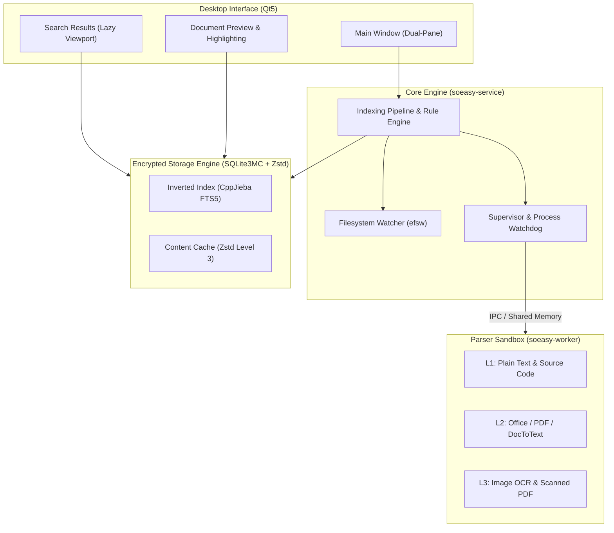

# SoEasy

> **Make every file searchable on your computer.**  
> *让电脑没有难搜的文件*

[English](README.md) | [简体中文](README_zh.md)

---

SoEasy is a native desktop full-text search engine and file workspace engineered for speed, privacy, and system resilience. Built with modern C++17 and Qt5, it indexes local documents, source trees, spreadsheets, presentations, PDFs, and scanned images entirely on your machine.

No Electron runtime. No telemetry. Sub-millisecond queries powered by an isolated multi-process architecture.

---

## Highlights

- **Sub-Millisecond Full-Text Retrieval**  
  Powered by SQLite FTS5 with CppJieba Chinese tokenization and BM25 relevance scoring. Real-time keyword highlighting and context snippets across large document collections.

- **Crash-Resilient Sandbox Architecture**  
  File parsing executes inside isolated worker processes managed by an out-of-process supervisor (`WorkerGuard`). Faulty, hung, or corrupted files trigger watchdog termination and transparent recovery with zero impact on UI responsiveness.

- **Zero Cloud / Purely Local Security**  
  Fully offline operation. Inverted indices and content caches are secured locally with transparent page-level AES-128 encryption (SQLite3MultipleCiphers) and Zstandard (Zstd) compression.

- **Broad Format Coverage & Natural In-Place Extraction**  
  Office and PDF extraction is powered by an enhanced fork of [DocToText (v5.1.2+)](https://github.com/lilucpp/doctotext). Features include in-place streaming OCR for embedded images, natural top-to-bottom reading order recovery for PDFs, smart deduplication on searchable PDFs, and automatic fallback for pure scanned documents. Native extractors handle code repositories, OpenDocument (ODF), Apple iWork, RTF, and EML. Standalone images are indexed via an embedded PP-OCRv6 deep learning engine.

- **Desktop-Native Dual-Pane Interface**  
  A responsive Master-Detail layout with instant file preview, keyboard navigation, and real-time directory monitoring (`efsw`) featuring event debouncing.

---

## Architecture



---

## Supported File Formats

| Category | File Extensions | Extractor Engine |
| :--- | :--- | :--- |
| **Plain Text & Code** | `.txt`, `.md`, `.log`, `.csv`, `.json`, `.xml`, `.html`, `.c`, `.cpp`, `.py`, `.go`, `.rs`, `.java`, `.ts`, `.sh`, etc. | L1 Native Parser + uchardet |
| **Microsoft Office (OOXML)** | `.docx`, `.xlsx`, `.pptx` | L2 DocToText / Fast ZIP XML |
| **Classic Office** | `.doc`, `.xls`, `.ppt`, `.xlsb` | L2 DocToText |
| **OpenDocument (ODF)** | `.odt`, `.ods`, `.odp`, `.odg`, `.fodt`, `.fods`, `.fodp` | L2 DocToText |
| **Portable Document** | `.pdf` (text layer & scanned documents) | L2 Poppler & DocToText |
| **Apple iWork** | `.pages`, `.numbers`, `.key`, `.keynote` | L2 DocToText |
| **Rich Text & Mail** | `.rtf`, `.eml` | L2 DocToText |
| **Images & Scanned Media** | `.png`, `.jpg`, `.jpeg`, `.webp`, `.bmp`, `.tiff`, `.tif`, `.jfif`, `.pnm` | L3 PP-OCRv6 Deep Learning Engine |
| **Archives (Planned)** | `.zip`, `.tar`, `.gz`, `.7z`, `.rar`, `.bz2`, `.xz` *(UI disabled until released)* | Recursive Archive Extractor (TODO) |

---

## Getting Started

### Prerequisites

- **Compiler**: GCC 8+, Clang 9+, or MSVC 2019+ (C++17 required)
- **CMake**: 3.16+
- **Libraries**: Qt5 (`Widgets`, `Gui`, `Core`), Cap'n Proto, uchardet, zlib, libxml2, OpenCV

### Linux Native Build

```bash
# Configure release build
cmake -B build -DCMAKE_BUILD_TYPE=Release

# Compile all targets
cmake --build build -j$(nproc)

# Launch
./build/soeasy-gui
```

### Linux Distribution Package

```bash
bash scripts/package.sh
```
Output artifact: `dist/soeasy-v0.1.0-linux-x86_64.zip`.

### Windows (x64) Cross-Compilation via Docker

SoEasy supports reproducible, single-command Windows builds directly on Linux using containerized MinGW-w64:

```bash
# 1. Build the MinGW cross-compilation image
docker build -f Dockerfile.win64 -t soeasy-win64-cross .

# 2. Compile and package the standalone Windows zip release
./scripts/package_win64_docker.sh
```

Output artifact: `dist/soeasy-v0.1.0-windows-x64.zip`. Extract on any 64-bit Windows machine and run `bin/soeasy-gui.exe`.

---

## Verification & Benchmarks

The project includes unit and micro-benchmark suites to verify indexing throughput and extraction robustness:

```bash
# Verify encrypted storage engine & FTS5 indexing
./build/test_storage_engine

# Run multi-format Office / PDF extraction suite
./build/test_office_parser

# Profile parser logging performance impact
./build/test_log_impact
```

---

## Core Dependencies & Acknowledgements

SoEasy is built on top of high-performance open-source foundations:
- **[DocToText (lilucpp fork)](https://github.com/lilucpp/doctotext)**: Powers multi-format extraction for Office and PDF. Upgrades over upstream include in-place embedded image OCR streaming, natural top-to-bottom reading order recovery for PDFs, automatic scanned PDF fallback, and a robust C ABI for cross-compiler stability.
- **[SQLite3MultipleCiphers](https://github.com/utelle/SQLite3MultipleCiphers)**: Transparent page-level AES-128 index database encryption.
- **[CppJieba](https://github.com/yanyiwu/cppjieba)**: High-speed Chinese tokenization for SQLite FTS5.
- **[Zstandard](https://github.com/facebook/zstd)**: High-ratio realtime document content compression.
- **[efsw](https://github.com/SpartanJ/efsw)**: Cross-platform asynchronous filesystem event watcher.

---

## License

SoEasy is open source under the [Apache-2.0 License](LICENSE).
