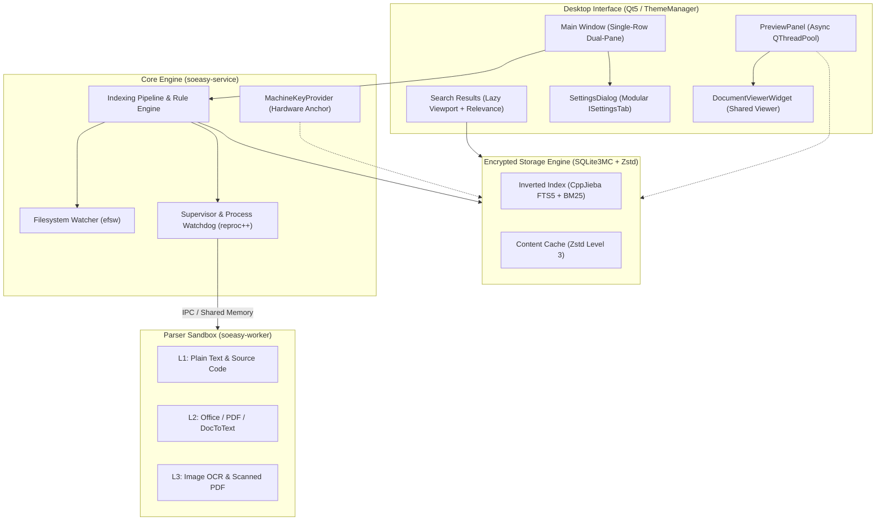

# SoEasy

> **Make every file searchable on your computer.**  
> *让电脑没有难搜的文件*

[English](README.md) | [简体中文](README_zh.md)

---

SoEasy is a native desktop full-text search engine and file workspace engineered for speed, privacy, and system resilience. Built with modern C++17 and Qt5, it indexes local documents, source trees, spreadsheets, presentations, PDFs, and scanned images entirely on your machine.

No Electron runtime. No telemetry. Sub-millisecond queries powered by an isolated multi-process architecture.

---

## Highlights

- **Sub-Millisecond Full-Text Retrieval**  
  Powered by SQLite FTS5 with CppJieba Chinese tokenization and BM25 relevance scoring. Real-time keyword highlighting and context snippets across large document collections.

- **Crash-Resilient Sandbox & Modern Process Lifecycle Governance**  
  File parsing executes inside isolated worker processes managed by an out-of-process supervisor (`WorkerGuard`) via shared memory (SHM) and Cap'n Proto IPC. Integrates modern `reproc++` with standard `stop_actions` to strictly govern child process lifecycles and eliminate zombie processes (`<defunct>`). On Linux, utilizes Abstract UNIX Domain Sockets for kernel-managed IPC with zero leftover filesystem artifacts. Corrupted, hanging, or crashing files trigger watchdog termination and transparent recovery with zero UI stutter.

- **Double-Array Trie (DAT) + mmap Zero-Heap Tokenization**  
  The 350,000-word Jieba dictionary is precompiled into a compact Double-Array Trie (DAT) binary using Darts-clone and mapped directly into memory via `mmap`. Eliminates runtime node allocation, reducing heap memory overhead from **120 MB down to 7 MB** while delivering instantaneous cold-boot startup and an overlay dictionary for custom vocabularies.

- **Low-Latency Scientific OCR Optimization Engine**  
  Features an embedded PP-OCRv6 engine with in-memory zero-allocation Header Probe (< 1 µs) to filter out icons, decorative lines, and blank backgrounds before decoding. Dual-limit resolution scaling (736px for standalone documents, 640px for document-embedded images) cuts memory usage by 34% and accelerates inference by > 40% with zero accuracy loss. Constrains glibc multi-arena memory fragmentation via `mallopt(M_ARENA_MAX, 2)`.

- **Zero Cloud, Hardware-Bound Local Security (FEAT-006)**  
  Fully offline operation. Inverted indices and content caches are secured locally with transparent page-level AES-128 encryption (SQLite3MultipleCiphers) and Zstandard (Zstd) compression. Features **Machine-Bound Envelope Encryption** (`MachineKeyProvider`): each installation derives a unique, high-entropy 256-bit Data Encryption Key (DEK) sealed with OS identity (`/etc/machine-id` on Linux, DPAPI on Windows), completely eliminating hardcoded credentials while preventing offline data theft across foreign machines.

- **Broad Format Coverage & Natural In-Place Extraction**  
  Office and PDF extraction is powered by an enhanced fork of [DocToText (v5.1.2+)](https://github.com/lilucpp/doctotext). Features include in-place streaming OCR for embedded images, natural top-to-bottom reading order recovery for PDFs, smart deduplication on searchable PDFs, and automatic fallback for pure scanned documents. Native extractors handle code repositories, OpenDocument (ODF), Apple iWork, RTF, and EML. Standalone images are indexed via an embedded PP-OCRv6 deep learning engine.

- **Modernized Modular Qt Architecture & Asynchronous Preview**  
  Engineered with high modularity and clean separation of concerns:
  - **Asynchronous Document Viewer**: Reusable `DocumentViewerWidget` with keyword highlight badges, multi-occurrence navigation, and fast jump. File decompression and content loading are offloaded to background worker threads (`QThreadPool`) with request-id debouncing, ensuring 60 FPS stutter-free list navigation.
  - **Decoupled Settings Center**: Replaces monolithic dialogs with 6 independent, single-responsibility tab modules (`General`, `Directories`, `Patterns`, `Extensions`, `UserDict`, `Performance`).
  - **Centralized Design System**: Unified design tokens and styles managed via `ThemeManager` and `theme_light.qss`.
  - **Custom Dictionary Management (FEAT-002)**: Visual editor for user vocabulary extensions and custom word frequency tuning, dynamically compiled into an in-memory overlay without restarting.

- **Desktop-Native Dual-Pane Interface & Keyboard-Centric Workflow**  
  A distraction-free, single-row searchbar with instant mode switching (FTS5 Full-Text vs. Instant Filename Search). Features a responsive Master-Detail layout with live keyword-highlighted content preview, dedicated BM25 relevance sorting, full keyboard-centric navigation (<kbd>Enter</kbd> to open with system defaults, <kbd>Ctrl+O</kbd> to reveal in file manager, <kbd>Ctrl+,</kbd> for system settings, <kbd>Ctrl+P</kbd> preview toggle, <kbd>F1</kbd> shortcut guide, <kbd>Esc</kbd> to clear/minimize), and real-time directory monitoring (`efsw`) with event debouncing.

---

## Architecture



---

## Supported File Formats

| Category | File Extensions | Extractor Engine |
| :--- | :--- | :--- |
| **Plain Text & Code** | `.txt`, `.md`, `.log`, `.csv`, `.json`, `.xml`, `.html`, `.c`, `.cpp`, `.py`, `.go`, `.rs`, `.java`, `.ts`, `.sh`, etc. | L1 Native Parser + uchardet |
| **Microsoft Office (OOXML)** | `.docx`, `.xlsx`, `.pptx` | L2 DocToText / Fast ZIP XML |
| **Classic Office** | `.doc`, `.xls`, `.ppt`, `.xlsb` | L2 DocToText |
| **OpenDocument (ODF)** | `.odt`, `.ods`, `.odp`, `.odg`, `.fodt`, `.fods`, `.fodp` | L2 DocToText |
| **Portable Document** | `.pdf` (text layer & scanned documents) | L2 Poppler & DocToText |
| **Apple iWork** | `.pages`, `.numbers`, `.key`, `.keynote` | L2 DocToText |
| **Rich Text & Mail** | `.rtf`, `.eml` | L2 DocToText |
| **Images & Scanned Media** | `.png`, `.jpg`, `.jpeg`, `.webp`, `.bmp`, `.tiff`, `.tif`, `.jfif`, `.pnm` | L3 PP-OCRv6 Deep Learning Engine |
| **Archives (Planned)** | `.zip`, `.tar`, `.gz`, `.7z`, `.rar`, `.bz2`, `.xz` *(UI disabled until released)* | Recursive Archive Extractor (TODO) |

---

## Getting Started

### Prerequisites

- **Compiler**: GCC 8+, Clang 9+, or MSVC 2019+ (C++17 required)
- **CMake**: 3.16+
- **Libraries**: Qt5 (`Widgets`, `Gui`, `Core`), Cap'n Proto, uchardet, zlib, libxml2, OpenCV

### Linux Native Build

```bash
# Configure release build
cmake -B build -DCMAKE_BUILD_TYPE=Release

# Compile all targets
cmake --build build -j$(nproc)

# Launch
./build/soeasy-gui
```

### Linux Distribution Package

```bash
bash scripts/package.sh
```
Output artifact: `dist/soeasy-linux-x86_64.zip`.

### Windows (x64) Cross-Compilation via Docker

SoEasy supports reproducible, single-command Windows builds directly on Linux using containerized MinGW-w64:

```bash
# 1. Build the MinGW cross-compilation image
docker build -f Dockerfile.win64 -t soeasy-win64-cross .

# 2. Compile and package the standalone Windows zip release
./scripts/package_win64_docker.sh
```

Output artifact: `dist/soeasy-windows-x64.zip`. Extract on any 64-bit Windows machine and run `bin/soeasy-gui.exe`.

---

## Performance & Resource Footprint

Empirically measured under Linux x86_64 (Release build):

| State / Operation | Total RAM (RSS) | CPU Usage | Details |
| :--- | :--- | :--- | :--- |
| **Idle / Background** | **~82 MB** (Total) | **0.0%** | GUI: ~76 MB, Workers: **0 MB** (0 processes, lazy spawn & 60s idle eviction), OCR: 0 MB, SHM Pool: 6 MB (3 slots × 2MB). Down ~81% from original 434 MB. |
| **Peak Indexing Burst** | **~377 MB** | **~120%** | GUI + 2 Worker processes. Large texts (>2MB) spill to disk cache with 4-tier cleanup guarantee. |
| **Filename Query (10k+ files)** | Negligible | < 1% | **< 2.0 ms** response latency via lock-free in-memory `NameIndex`. |
| **Encrypted Fulltext Query** | Negligible | < 2% | **< 0.5 ms** per query via SQLite3MC AES-128 + FTS5 (Jieba). |
| **Zstd Decompression** | Negligible | < 1% | **> 5,800 MB/s** throughput for instantaneous preview rendering. |

---

## Verification & Benchmarks

The project includes unit and micro-benchmark suites to verify indexing throughput and extraction robustness:

```bash
# Run full automated test suite (65 suites: unit, integration, benchmarks)
cd build && ctest --output-on-failure

# Verify machine-bound envelope encryption (FEAT-006)
./build/test_machine_key_provider_gtest

# Run headless Qt GUI smoke verification
./build/test_gui_smoke

# Run multi-format Office / PDF extraction suite
./build/test_office_parser
```

---

## Core Dependencies & Acknowledgements

SoEasy is built on top of high-performance open-source foundations:
- **[DocToText (lilucpp fork)](https://github.com/lilucpp/doctotext)**: Powers multi-format extraction for Office and PDF. Upgrades over upstream include in-place embedded image OCR streaming, natural top-to-bottom reading order recovery for PDFs, automatic scanned PDF fallback, and a robust C ABI for cross-compiler stability.
- **[SQLite3MultipleCiphers](https://github.com/utelle/SQLite3MultipleCiphers)**: Transparent page-level AES-128 index database encryption.
- **[SQLiteCpp](https://github.com/SRombauts/SQLiteCpp)**: Modern C++ RAII wrapper and transaction guard for SQLite.
- **[CppJieba](https://github.com/yanyiwu/cppjieba)**: High-speed Chinese tokenization for SQLite FTS5.
- **[Darts-clone](https://github.com/s-yata/darts-clone)**: Double-Array Trie library powering the zero-heap mmap DAT dictionary.
- **[reproc / reproc++](https://github.com/DaanDeMeyer/reproc)**: Cross-platform process and IPC library eliminating zombie and orphan processes.
- **[Zstandard](https://github.com/facebook/zstd)**: High-ratio realtime document content compression.
- **[efsw](https://github.com/SpartanJ/efsw)**: Cross-platform asynchronous filesystem event watcher.

---

## License

SoEasy is open source under the [Apache-2.0 License](LICENSE).
