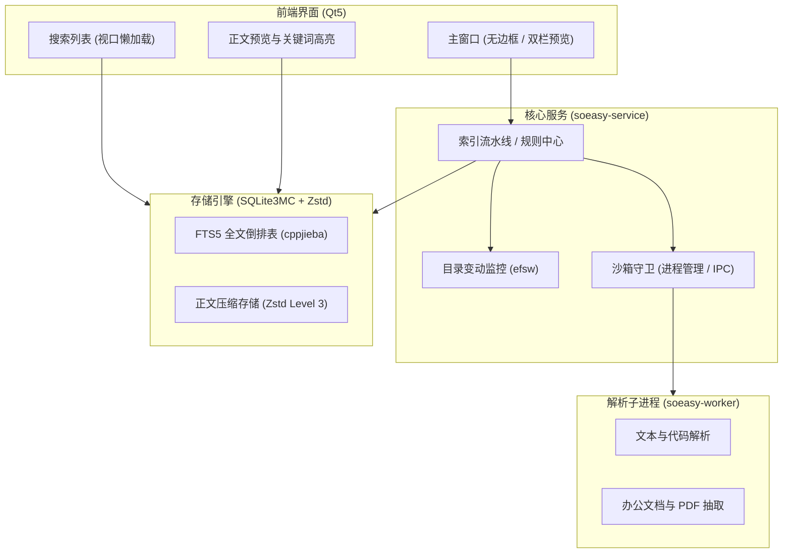

# SoEasy (Sou Easy)

基于 C++17 与 Qt5 的跨平台桌面全文检索与文件管理工具。

## 功能特性

- **全文检索与即时高亮**：基于 SQLite FTS5 与 cppjieba 中文分词，支持正文关键词检索与上下文高亮摘要。
- **多格式解析支持**：
  - 纯文本与源码：`.txt`, `.md`, `.log`, `.csv`, `.json`, `.xml`, `.html` 及常见编程语言源码。
  - 办公与版式文档：`.doc`, `.docx`, `.xls`, `.xlsx`, `.ppt`, `.pptx`, `.pdf`。
- **多进程解析沙箱**：解析器与主服务进程物理隔离，支持超时强杀与异常自愈，防止复杂或损坏文档影响主程序稳定性。
- **本地密态存储**：基于 SQLite3MultipleCiphers (AES-128) 对索引库进行透明页级加密，文档全文采用 Zstandard (Zstd) 压缩存储。
- **实时监控与增量索引**：监听目录变动事件并进行去抖合并，自动维护增量索引。
- **双栏预览交互**：提供搜索结果列表与右侧即时正文预览（Master-Detail 布局），支持文档内关键词匹配跳转与定位。

## 架构概览



## 编译与运行

### 依赖环境

- **编译器**：支持 C++17 的 GCC 8+、Clang 9+ 或 MSVC 2019+
- **CMake**：3.16 及以上
- **依赖库**：Qt5 (Widgets, Gui, Core)、Cap'n Proto、uchardet、DocToText、zlib、libxml2

### 编译步骤

```bash
# 生成构建目录
cmake -B build -DCMAKE_BUILD_TYPE=Release

# 编译项目
cmake --build build -j4

# 运行 GUI
./build/soeasy-gui
```

### 运行测试

```bash
export LD_LIBRARY_PATH=./third_party/sysroot/usr/lib/x86_64-linux-gnu:$LD_LIBRARY_PATH

# 存储引擎基准测试
./build/test_storage_engine

# GUI 前端集成验证
./build/test_gui_smoke
```

### 打包分发

```bash
bash scripts/package.sh
```
打包输出产物位于 `dist/soeasy-v1.0.0-linux-x86_64.zip`。

## 目录结构

```text
soeasy/
├── CMakeLists.txt          # CMake 构建配置
├── README.md               # 项目说明文档
├── schema/                 # 进程间通信协议 (Cap'n Proto)
├── scripts/                # 打包与发布脚本
├── src/
│   ├── common/             # 共享内存、日志工具
│   ├── gui/                # Qt5 界面组件 (主窗口、搜索栏、列表、预览)
│   ├── service/            # 索引流水线、目录监控、沙箱守卫
│   ├── storage/            # 存储引擎、FTS5 结巴分词器
│   └── worker/             # 解析子进程及各格式抽取器
├── tests/                  # 自动化测试用例
└── third_party/            # 第三方依赖与头文件
```

## 许可证

本项目基于 [MIT License](LICENSE) 开源。
