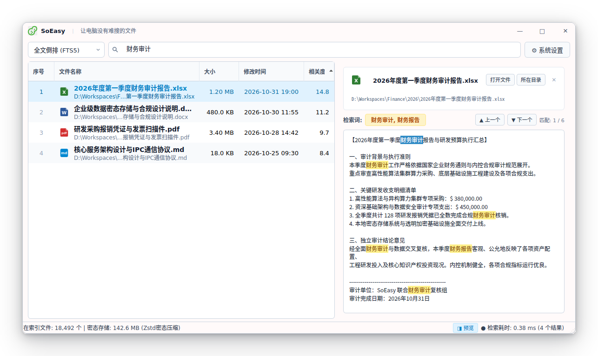

# SoEasy

> **Make Every File Searchable On Your Desktop**  
> *让电脑没有难搜的文件*

[English](README.md) | [简体中文](README_zh.md) | [Changelog (v0.4.6)](CHANGELOG.md) | [Latest Release](https://github.com/lilucpp/soeasy/releases/latest)

---

SoEasy is a native, privacy-first, ultra-fast desktop search engine. Built with modern C++17 and Qt5, it indexes and searches source code repositories, Office suites, spreadsheets, presentations, PDFs, and scanned documents entirely offline with sub-millisecond query response and instant content preview.

Zero Electron bloat, zero cloud telemetry, and complete crash resilience through multi-process sandbox isolation.

<p align="center">
  
</p>

---

## Highlights

- **Instant Full-Text & Filename Search**: Powered by SQLite FTS5 with Double-Array Trie Jieba tokenization and BM25 ranking. Features live debounced in-document keyword preview.
- **Crash-Resilient Sandbox Isolation**: All document parsing runs within an isolated subprocess (`soeasy-worker`) governed by lightweight `subprocess.h` with custom RAII lifecycle management. Malformed or looping files are killed and self-healed in milliseconds without freezing the UI.
- **Dual-Mode Operation (GUI + Headless CLI)**: Offers both a responsive native desktop GUI (`soeasy-gui`) and an independent headless CLI executable (`soeasy-cli`) built strictly with the C++17 standard library and core engine (zero Qt dependencies), purpose-built for Unix pipelines, JSON integration, and background automation.
- **Cap'n Proto Chunked Streaming & O(1) Cold Boot**: Replaces temporary `.spill` disk files with a 256KB capability chunk streaming protocol (`TextStreamReceiver`). Cold start utilizes a single-step streaming cursor, eliminating heap spikes ($O(N) \to O(1)$) and cutting initialization time by **55.5%**.
- **Double-Array Trie (DAT) + mmap Tokenization**: Precompiles 350,000 dictionary words into contiguous DAT binary blocks, mapped via kernel `mmap`. Memory footprint plunges from **120 MB down to 7.2 MB** (94% RAM reduction).
- **Lightweight Deep Learning OCR**: Bundles PP-OCRv6 with zero-allocation Header Probe nanosecond sniffing ($< 1\,\mu\text{s}$) to filter micro-icons and borders before decoding. Cuts RAM by 34% and accelerates inference by >40%.
- **Hardware-Bound Local Encryption**: Zero cloud dependence. Index databases are protected with page-level AES-128 encryption (SQLite3MultipleCiphers) and Zstandard Level 3 compression, bound to host hardware to prevent offline theft.
- **Modern Component Architecture**: Features composite filename and path presentation, a clean single-line search bar, full keyboard navigation (<kbd>Enter</kbd>, <kbd>Ctrl+O</kbd>, <kbd>Ctrl+P</kbd>, <kbd>F3</kbd>), and real-time incremental filesystem watching.

> 💡 **Deep Architectural Specifications**: For in-depth implementation details on process supervision, DAT Trie derivation, nanosecond Header Probe heuristics, and machine-bound envelope encryption, see 📖 **[Deep Architectural Principles (docs/features.md)](docs/features.md)**.

---

## Architecture Overview

```mermaid
flowchart TD
    subgraph UI ["Presentation Layer (Dual-Mode)"]
        subgraph GUI ["Desktop Client (soeasy-gui / Qt5)"]
            MainWindow["MainWindow (Single-Line Bar & Dual-Pane)"]
            ResultView["ResultView (Virtual Viewport & Hover Preview)"]
            PreviewPanel["PreviewPanel & DocumentViewerWidget"]
            MainWindow --> ResultView
            MainWindow --> PreviewPanel
        end
        subgraph CLI ["Independent Headless Tool (soeasy-cli / Pure C++)"]
            CliMain["soeasy-cli (search / stats / index / --json)"]
        end
    end

    subgraph Core ["Core Service Layer (soeasy-service / CQRS Decoupled)"]
        IndexPipeline["IndexPipeline (Service Facade)"]

        subgraph QuerySide ["Query Side (Read Channel)"]
            SearchCoord["ISearchCoordinator / SearchCoordinator"]
            NameIndex["NameIndex (In-Memory Instant Index, O(1) Cursor Cold Boot)"]
            SearchCoord --> NameIndex
        end

        subgraph CommandSide ["Command Side (Write Channel)"]
            Orchestrator["IndexOrchestrator (Concurrent Scheduler)"]
            Crawler["FileCrawler (Recursive Traversal & Mount Loop Guard)"]
            Reconciler["WatchReconciler (Two-Phase Watch-First Reconcile)"]
            Reclaimer["SpaceReclaimer (Paced Low-Priority SQLite Vacuum)"]
            Policy["PathFilterPolicy (Stateless Matching Policy)"]
            WatchEngine["WatchEngine & EventDebouncer (efsw)"]
            WorkerGuard["WorkerGuard (subprocess.h Sandbox Watchdog + Stdio Ring-Buffer)"]
            WriteQueue["AsyncWriteQueue (Batched Writer)"]

            Orchestrator --> Crawler
            Orchestrator --> Reconciler
            Orchestrator --> Reclaimer
            Orchestrator --> Policy
            Orchestrator --> WatchEngine
            Orchestrator --> WorkerGuard
            Orchestrator --> WriteQueue
        end

        IndexPipeline --> SearchCoord
        IndexPipeline --> Orchestrator
    end

    subgraph Sandbox ["Isolated Parser Process (soeasy-worker)"]
        ParserRouter["Tiered Parser Router (L1 Stream / L2 Office & PDF / L3 PP-OCRv6)"]
    end

    subgraph Storage ["Storage & Infrastructure Layer (soeasy-storage / common)"]
        subgraph ISP ["Interface Segregation Roles (ISP / CQRS)"]
            IReader["«interface» IDocumentSearchReader"]
            IWriter["«interface» IDocumentIndexWriter"]
            IMaint["«interface» IStorageMaintenance"]
        end
        IStorage["«interface» IStorageEngine"]
        StorageEngine["StorageEngine (SQLite3MC AES-128 + Zstd)"]
        Subsystems["ReaderConnectionPool | Fts5JiebaTokenizer (DAT+mmap) | MachineKeyProvider"]

        IStorage --> IReader
        IStorage --> IWriter
        IStorage --> IMaint
        StorageEngine -.->|"implements"| IStorage
        StorageEngine --> Subsystems
    end

    MainWindow --> IndexPipeline
    CliMain --> SearchCoord
    CliMain --> StorageEngine
    ResultView --> SearchCoord
    PreviewPanel --> SearchCoord
    SearchCoord --> IReader
    WriteQueue --> IWriter
    Reclaimer --> IMaint
    WorkerGuard ==>|"Cap'n Proto 256KB Chunk Streaming (Zero Disk Spill)"| ParserRouter
```



---

## Supported Formats

| Category | File Extensions | Extraction Engine |
| :--- | :--- | :--- |
| **Plain Text & Source Code** | `.txt`, `.md`, `.log`, `.csv`, `.json`, `.xml`, `.html`, `.c`, `.cpp`, `.py`, `.go`, `.rs`, `.java`, `.ts`, `.sh`, etc. | L1 Native parser + uchardet auto-sniffing |
| **Microsoft Office (OOXML)** | `.docx`, `.xlsx`, `.pptx` | L2 DocToText / Fast stream extraction |
| **Microsoft Office Binary** | `.doc`, `.xls`, `.ppt`, `.xlsb` | L2 DocToText binary extractors |
| **WPS Office Suite** | `.wps`, `.et`, `.dps` | L2 DocToText |
| **OpenDocument (ODF)** | `.odt`, `.ods`, `.odp`, `.odg`, `.fodt`, `.fods`, `.fodp` | L2 DocToText |
| **Portable Documents** | `.pdf` (text layer + automatic scan queueing) | L2 Poppler natural flow + OCR fallback |
| **Apple iWork** | `.pages`, `.numbers`, `.key`, `.keynote` | L2 DocToText |
| **Rich Text & Emails** | `.rtf`, `.eml` | L2 DocToText |
| **Images & Vector Graphics** | `.png`, `.jpg`, `.jpeg`, `.webp`, `.bmp`, `.tiff`, `.tif`, `.jfif`, `.pnm`, `.svg` | L3 PP-OCRv6 deep learning OCR + SVG Parser |

> 📌 **Roadmap**: Recursive extraction and streaming search for compressed archives (`.zip`, `.tar`, `.gz`, `.7z`, `.rar`, `.bz2`, `.xz`) are planned for future releases (currently greyed out in settings).

---

## Search Syntax (FTS5)

SoEasy provides three search modes in the top-left selector:
- **Hybrid**: Combines instant filename/pinyin matches (boosted) with FTS5 full-text matches.
- **Full-Text (FTS5)**: Queries the SQLite FTS5 inverted index (`file_name` and `body` columns) with a case-insensitive Jieba tokenizer and `bm25` relevance ranking.
- **Filename**: Ultra-fast in-memory trie, substring, and pinyin matching on file names only.

### Supported FTS5 Syntax

| Syntax | Example | Behavior |
| :--- | :--- | :--- |
| **Single / Continuous CJK** | `内存`, `高性能分布式搜索引擎` | Jieba word segmentation; index-time CJK character colocation also enables single-character matches |
| **Implicit AND** | `sqlite indexing` | Space-separated terms must all appear in the document |
| **Boolean Operators** | `sqlite AND arch`, `mysql OR pytorch`, `全文检索 NOT 结巴` | Standard FTS5 `AND`, `OR`, `NOT` (operators must be **uppercase**) |
| **Parentheses Grouping** | `(sqlite OR mysql) AND storage` | Explicit operator precedence |
| **Prefix Wildcard (`*`)** | `data*`, `搜索*` | Matches any token starting with the given prefix |
| **Exact Phrase (`"..."`)** | `"虚拟地址转换"`, `"lock-free"` | Matches tokens consecutively in exact order |
| **Column Filter** | `file_name: "cpp_concurrency.cpp"`, `body: 倒排索引` | Restricts matching to `file_name` or `body` |
| **Proximity (`NEAR`)** | `NEAR(全文检索 分词, 5)` | Matches when terms are separated by at most `N` **tokens** (words, not characters; requires ASCII `,`) |
| **Special Symbol Fallback** | `C++`, `lock-free` | Queries that trigger an FTS5 syntax error automatically fall back to quoted literal tokens without failing |

> 💡 **Practical Notes**:
> - Boolean keywords (`AND`, `OR`, `NOT`) must be uppercase; lowercase words are treated as normal search terms.
> - `NEAR(term1 term2, N)` measures distance in **segmented tokens** rather than raw character count (e.g., an unbroken `xxxxxxxx` counts as 1 token), and requires an ASCII comma `,`.
> - Path scoping in the search bar filters results by directory prefix (case-insensitive on Windows).

---

## Command Line Interface (`soeasy-cli`)

For headless server environments, automated workflows, and terminal power-users, SoEasy provides an independent native CLI binary `soeasy-cli`.

- **Zero GUI Overhead**: Built strictly with C++17 standard library and core engine services (no Qt linkage);
- **Unix Pipeline Ready**: Strictly separates data from diagnostics (results and JSON to `stdout`, progress and diagnostics to `stderr`);
- **Predictable Exit Codes**: `0` (success/matches found), `1` (no matches or execution error), `2` (argument parsing error).

```bash
# 1. Basic keyword search (returns top 50 matches by default)
soeasy-cli search "concurrency" --limit 10

# 2. Output structured JSON with extracted text snippets for piping into jq
soeasy-cli search "algorithm" --json --snippet | jq '.results[0]'

# 3. Path prefix filtering
soeasy-cli search "CMakeLists" --path "/home/peanut/project"

# 4. Inspect index metrics and database fragmentation
soeasy-cli stats --json

# 5. Index a directory or standalone file
soeasy-cli index /path/to/documents -v
```

---

## Installation & Releases

Prebuilt release packages for **Linux (x86_64)** and **Windows (x64)** are published on [GitHub Releases](https://github.com/lilucpp/soeasy/releases) with `SHA256SUMS.txt` verification (see [CHANGELOG.md](CHANGELOG.md) for version notes):

- **Ubuntu / Debian (x86_64)**: Install the `.deb` package (`soeasy_<version>_amd64.deb`, installed under `/opt/soeasy` with `soeasy-gui` desktop entry and `soeasy-cli` on `PATH`), or extract the portable `.zip` archive and run `./run.sh`.
- **Windows 10 / 11 (64-bit)**: Run `soeasy-v<version>-windows-x64-setup.exe` (guided installer with Start Menu / Desktop shortcuts and optional user data cleanup on uninstall), or extract `soeasy-v<version>-windows-x64.zip` and run `soeasy-gui.exe` directly. *(Windows 7 / 8 / 8.1 are not supported because bundled ONNX Runtime v1.20.0 requires Windows 10+ 64-bit APIs.)*

---

## Building from Source

### Prerequisites
- **Clone**: Use `git clone --recursive` to initialize all submodules
- **Compiler**: GCC 8+ or Clang 9+ supporting C++17 (MSYS2 MinGW-w64 recommended on Windows)
- **CMake**: 3.16 or higher
- **Dependencies**: Qt5 (`Widgets`, `Gui`, `Core`), Cap'n Proto, uchardet, zlib, libxml2, libiconv, OpenCV, Boost

### Linux Quick Start

```bash
# Generate Release configuration
cmake -B build -DCMAKE_BUILD_TYPE=Release

# Build in parallel
cmake --build build -j$(nproc)

# Run full test suite
ctest --test-dir build --output-on-failure

# Launch SoEasy GUI or CLI
./build/soeasy-gui
./build/soeasy-cli --help
```

### Windows Build (MSYS2 MinGW-w64)

> 💡 Aligned with official GitHub Actions CI: MSYS2 MINGW64 environment is recommended:

```bash
# 1. Open MSYS2 MINGW64 terminal and install toolchain & dependencies
pacman -S --noconfirm \
  git base-devel \
  mingw-w64-x86_64-toolchain \
  mingw-w64-x86_64-cmake \
  mingw-w64-x86_64-ninja \
  mingw-w64-x86_64-qt5-base \
  mingw-w64-x86_64-capnproto \
  mingw-w64-x86_64-opencv \
  mingw-w64-x86_64-libxml2 \
  mingw-w64-x86_64-libiconv \
  mingw-w64-x86_64-zlib \
  mingw-w64-x86_64-uchardet \
  mingw-w64-x86_64-boost

# 2. Configure and build with Ninja
cmake -B build -G "Ninja" -DCMAKE_BUILD_TYPE=Release
cmake --build build -j$(nproc)

# 3. Run full automated tests
ctest --test-dir build --output-on-failure

# 4. Launch GUI or CLI executable
./build/soeasy-gui.exe
./build/soeasy-cli.exe --help
```

---

## License

SoEasy is distributed under the [Apache-2.0 License](LICENSE).
