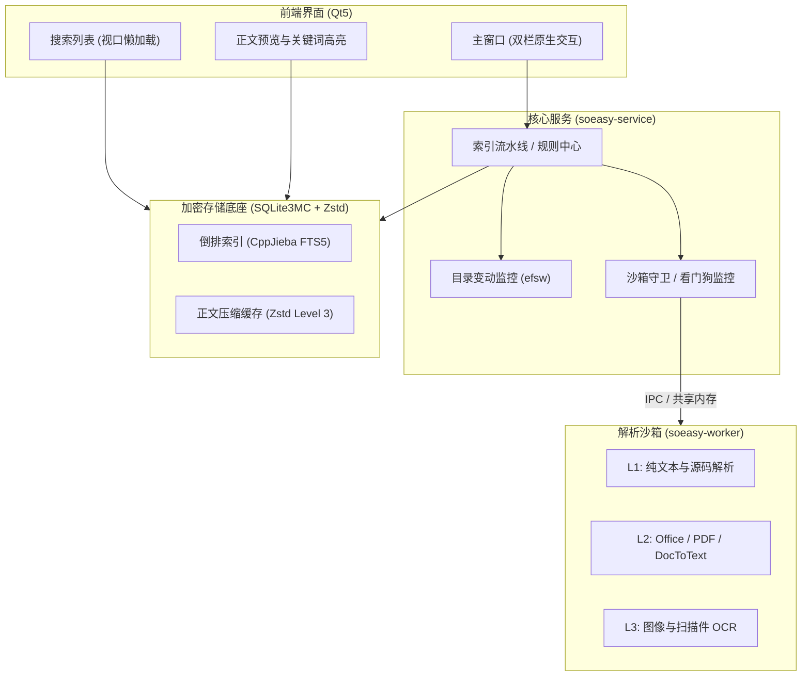

# SoEasy (搜易)

> **让电脑没有难搜的文件**  
> *Make every file searchable on your computer.*

[English](README.md) | [简体中文](README_zh.md)

---

SoEasy 是一款追求极速、安全与稳定的原生跨平台桌面全文检索工具。基于现代 C++17 与 Qt5 构建，完全在本地对代码仓库、文档资料、电子表格、演示文稿、PDF 与图片扫描件进行离线索引与毫秒级搜索。

无 Electron 容器，无云端数据上传，通过物理多进程隔离沙箱保障系统常驻运行的极致轻量与坚固稳定。

---

## 核心设计与特性

- **毫秒级即时全文检索**  
  底层集成 SQLite FTS5 倒排索引引擎与 CppJieba 中文分词，引入 BM25 算法优化相关度排序。支持海量文档中键入即搜，提供富文本上下文高亮摘要与位置定位。

- **崩溃自愈的沙箱隔离架构**  
  所有文件解析均置于独立的子进程 (`soeasy-worker`) 沙箱内运行，由主进程守卫 (`WorkerGuard`) 通过共享内存（SHM）与 Cap'n Proto 统一调度。若遇格式损坏、内存溢出或死循环解析，看门狗毫秒级强杀并透明自愈，彻底杜绝主程序与界面的卡死风险。

- **纯本地透明密态存储**  
  零网络依赖，杜绝任何数据上云。索引数据库与正文缓存均采用 SQLite3MultipleCiphers 进行透明页级 AES-128 加密，结合 Zstandard (Zstd) 高效压缩落盘，保障个人与企业数据隐私安全。

- **完备的格式覆盖能力**  
  集成 DocToText (v5.1.2) 与专用抽取器，开箱支持纯文本、主流编程源码、Office 新老版本格式（Word, Excel, PowerPoint）、开放文档 (ODF)、苹果 iWork、PDF、RTF 与 EML 邮件。对扫描版 PDF 与独立图像自动流转至内置的深度学习引擎（PP-OCRv6）进行光学字符识别补全。

- **双栏式原生桌面体验**  
  采用经典 Master-Detail 双栏视图，支持实时高亮预览与键盘快捷跳转；底层接入 `efsw` 监听文件变动，具备事件去抖合并与平滑增量热更新能力。

---

## 系统架构



---

## 支持格式列表

| 格式分类 | 文件扩展名 | 文本解析内核 |
| :--- | :--- | :--- |
| **纯文本与源代码** | `.txt`, `.md`, `.log`, `.csv`, `.json`, `.xml`, `.html`, `.c`, `.cpp`, `.py`, `.go`, `.rs`, `.java`, `.ts`, `.sh` 等 | L1 原生解析器 + uchardet 编码嗅探 |
| **Microsoft Office (OOXML)** | `.docx`, `.xlsx`, `.pptx` | L2 DocToText / 快速流解压抽取 |
| **Microsoft Office 经典二进制** | `.doc`, `.xls`, `.ppt`, `.xlsb` | L2 DocToText 专有提取器 |
| **开放文档格式 (ODF)** | `.odt`, `.ods`, `.odp`, `.odg`, `.fodt`, `.fods`, `.fodp` | L2 DocToText |
| **便携式版式文档** | `.pdf` (支持纯文本层及图片扫描件自动判定) | L2 Poppler 文本提取 + 扫描件转排队 |
| **苹果办公套件 (Apple iWork)** | `.pages`, `.numbers`, `.key`, `.keynote` | L2 DocToText |
| **富文本与电子邮件** | `.rtf`, `.eml` | L2 DocToText |
| **独立图像与扫描介质** | `.png`, `.jpg`, `.jpeg`, `.webp`, `.bmp`, `.tiff`, `.tif`, `.jfif`, `.pnm` | L3 PP-OCRv6 深度学习 OCR |
| **压缩归档格式 (规划中)** | `.zip`, `.tar`, `.gz`, `.7z`, `.rar`, `.bz2`, `.xz` *(界面暂置灰待支持)* | 待实现：递归解包检索流水线 (TODO) |

---

## 编译与运行

### 基础环境要求

- **编译器**：支持 C++17 的 GCC 8+、Clang 9+ 或 MSVC 2019+
- **CMake**：3.16 及以上版本
- **核心依赖**：Qt5 (`Widgets`, `Gui`, `Core`)、Cap'n Proto、uchardet、zlib、libxml2、OpenCV

### Linux 原生构建

```bash
# 生成 Release 构建配置
cmake -B build -DCMAKE_BUILD_TYPE=Release

# 编译所有组件
cmake --build build -j$(nproc)

# 启动应用程序
./build/soeasy-gui
```

### Linux 一键打包

```bash
bash scripts/package.sh
```
打包输出产物位于 `dist/soeasy-v0.1.0-linux-x86_64.zip`。

### Windows (x64) 容器化交叉编译

本项目提供基于 Docker 的 MinGW-w64 跨平台自动化交叉编译方案，无需 Windows 实体机即可在 Linux 宿主机上一键生成绿色便携包：

```bash
# 1. 构建 MinGW 交叉编译容器镜像
docker build -f Dockerfile.win64 -t soeasy-win64-cross .

# 2. 自动化编译并打包 Windows 发行版
./scripts/package_win64_docker.sh
```

生成的 Windows 发行包位于 `dist/soeasy-v0.1.0-windows-x64.zip`，解压至任意 64 位 Windows 机器即可直接运行 `bin/soeasy-gui.exe`。

---

## 质量验证与基准测试

项目内置了详尽的单元测试与微基准测试：

```bash
# 存储引擎与 FTS5 倒排索引吞吐基准
./build/test_storage_engine

# Office / PDF 多格式深度抽取与沙箱容错测试
./build/test_office_parser

# 解析日志输出对系统吞吐的影响分析
./build/test_log_impact
```

---

## 开源协议

本项目基于 [Apache-2.0 License](LICENSE) 授权开源。
