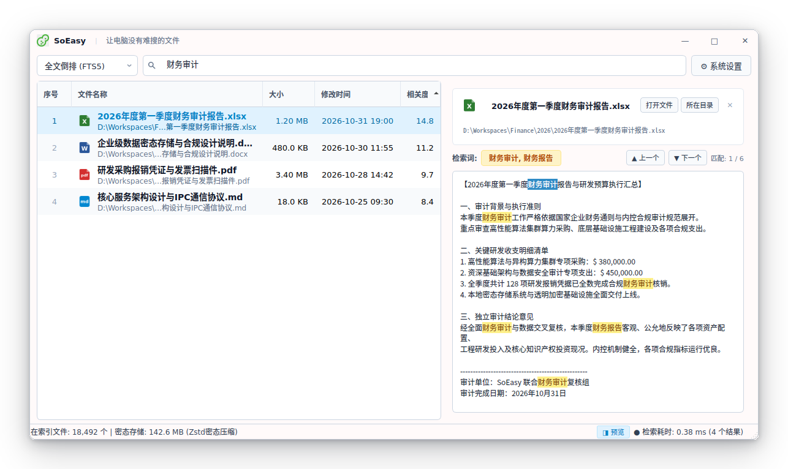
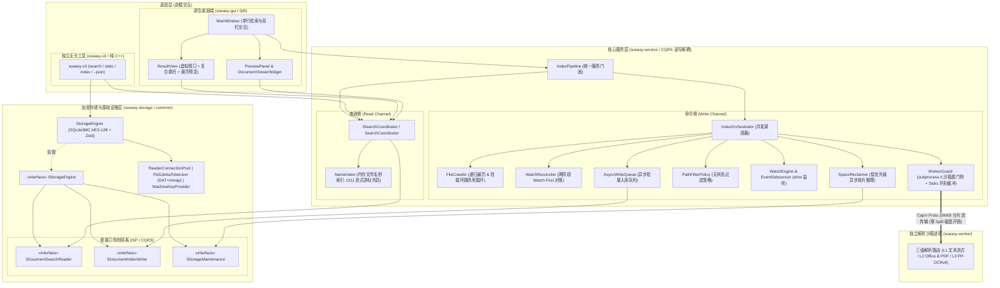

# SoEasy (搜易)

> **让电脑没有难搜的文件**  
> *Make every file searchable on your computer.*

[English](README.md) | [简体中文](README_zh.md) | [最新版本 (Latest Release)](https://github.com/lilucpp/soeasy/releases/latest)

---

SoEasy 是一款追求极速、安全与稳定的原生跨平台桌面全文检索工具。基于现代 C++17 与 Qt5 构建，完全在本地对代码工程、办公文档、电子表格、演示文稿、PDF 与图片扫描件进行离线索引与毫秒级即搜即览。

无 Electron 容器捆绑，无云端数据上传，通过物理多进程隔离沙箱保障常驻运行的极致轻量与坚固稳定。

<p align="center">
  
</p>

---

## 核心亮点速览

- **毫秒级即搜即览**：底层集成 SQLite FTS5 倒排索引引擎与结巴分词，引入 BM25 算法优化相关度排序，支持海量文档中键入即搜与实时高亮正文预览。
- **物理沙箱与崩溃自愈**：文件解析全部置于独立子进程 (`soeasy-worker`) 沙箱内运行，由主进程守卫 (`WorkerGuard`) 统一调度；遭遇死循环或损坏文件时毫秒级强杀自愈，界面永不卡死。
- **双模驱动与 Unix 工具拼装**：不仅提供清爽直观的 Qt5 双栏原生桌面客户端 (`soeasy-gui`)，还并列构建纯标准库无头 CLI 命令行工具 (`soeasy-cli`)，零 GUI 依赖，支持标准 Unix 流、JSON 格式化输出与脚本自动化拼装。
- **Cap'n Proto 流式分片 IPC 与 O(1) 冷启动**：全面收敛为成熟的 256KB 流式分片（`TextStreamReceiver`）传输机制，杜绝大文件磁盘临时 Spill 文件；冷启动采用单步流式游标，堆内存开销从 $O(N)$ 降至 $O(1)$，首屏加载速度提升 **55.5%**。
- **双数组 Trie (DAT) + mmap 零堆开销分词**：结巴 35 万词词典预编译为 DAT 二进制文件，运行时直接 `mmap` 零拷贝映射入内核内存页，词典常驻内存从 **120 MB 直降至 7.2 MB**（降低 94%）。
- **极速轻量 OCR 优化引擎**：内置 PP-OCRv6 深度学习引擎，引入独创 Header Probe 纳秒级嗅探提前过滤微型图标与单色块，结合双档位自适应限边检测，显存立降 34%，推理提速超 40%。
- **纯本地硬件绑定透明密态存储**：零网络依赖，拒绝遥测。索引库采用 SQLite3MultipleCiphers 进行页级 AES-128 强加密与 Zstd 高效压缩落盘，通过“一机一密”硬件信封加密技术防止脱机拷贝窃密。
- **现代化组件架构与极简交互**：文件名与路径智能复合呈现，单行搜索栏自由切换“全文倒排”与“文件名秒搜”，支持键盘优先全链路导航与毫秒级文件变动增量监听。

> 💡 **深入技术规格**：关于多进程沙箱治理机制、DAT+mmap 算法推导、Header Probe 纳秒过滤及一机一密加密体系的详尽设计，请参阅 📖 **[核心设计机制与底层架构规格说明 (docs/features_zh.md)](docs/features_zh.md)**。

---

## 系统架构



---

## 支持格式矩阵

| 格式分类 | 支持扩展名 | 文本抽取内核 |
| :--- | :--- | :--- |
| **纯文本与源代码** | `.txt`, `.md`, `.log`, `.csv`, `.json`, `.xml`, `.html`, `.c`, `.cpp`, `.py`, `.go`, `.rs`, `.java`, `.ts`, `.sh` 等 | L1 原生解析器 + uchardet 编码嗅探 |
| **Microsoft Office (OOXML)** | `.docx`, `.xlsx`, `.pptx` | L2 DocToText / 快速流解压抽取 |
| **Microsoft Office 经典二进制** | `.doc`, `.xls`, `.ppt`, `.xlsb` | L2 DocToText 专有提取器 |
| **金山 WPS 办公套件** | `.wps`, `.et`, `.dps` | L2 DocToText |
| **开放文档格式 (ODF)** | `.odt`, `.ods`, `.odp`, `.odg`, `.fodt`, `.fods`, `.fodp` | L2 DocToText |
| **便携式版式文档** | `.pdf` (原生文本层 + 纯图片扫描件排队) | L2 Poppler 自然排版提取 + 转入 OCR |
| **苹果办公套件 (Apple iWork)** | `.pages`, `.numbers`, `.key`, `.keynote` | L2 DocToText |
| **富文本与电子邮件** | `.rtf`, `.eml` | L2 DocToText |
| **独立图像与矢量图** | `.png`, `.jpg`, `.jpeg`, `.webp`, `.bmp`, `.tiff`, `.tif`, `.jfif`, `.pnm`, `.svg` | L3 PP-OCRv6 深度学习 OCR + SVG 原生解析 |

> 📌 **路线图规划**：压缩归档文件（`.zip`, `.tar`, `.gz`, `.7z`, `.rar`, `.bz2`, `.xz`）递归解包与流式检索功能排期演进中（当前设置界面中呈置灰禁用状态）。

---

## 检索语法与模式 (FTS5)

搜索栏左侧支持三种检索模式：
- **综合智能**：同时融合“文件名秒搜”（高权重置顶）与“全文倒排 (FTS5)”结果。
- **全文倒排 (FTS5)**：基于 SQLite FTS5 倒排索引（索引 `file_name` 与 `body` 两列）与自定义结巴分词器，按 `bm25` 相关性排序。
- **文件名秒搜**：基于内存 Trie/子串/拼音的高速文件名匹配。

### 支持的 FTS5 查询语法

| 语法类型 | 示例 | 说明 |
| :--- | :--- | :--- |
| **单词 / 中文连续句** | `内存`、`高性能分布式搜索引擎` | 中文走 `jieba` 精确分词；索引期写入单字同位词以支持单字命中复合词，英文不区分大小写 |
| **隐式 `AND`（空格）** | `sqlite indexing`、`分布式 倒排索引` | 空格分隔的词项需同时出现在文档中 |
| **显式布尔逻辑** | `sqlite AND arch`、`mysql OR pytorch`、`全文检索 NOT 结巴` | 支持 FTS5 原生 **`AND` / `OR` / `NOT`**（操作符须**大写**） |
| **括号分组** | `(sqlite OR mysql) AND storage` | 显式控制逻辑组合优先级 |
| **前缀通配符 (`*`)** | `data*`、`搜索*` | 匹配以指定词干/前缀开头的词条 |
| **精确短语 (`"..."`)** | `"虚拟地址转换"`、`"lock-free"` | 按分词顺序连续精确匹配 |
| **字段限定（列过滤）** | `file_name: "cpp_concurrency.cpp"`、`body: 倒排索引` | 限定仅检索文件名（`file_name`）或正文（`body`） |
| **邻近检索 (`NEAR`)** | `NEAR(全文检索 分词, 5)` | 两词间隔不超过 `N` 个 **Token（词数，非字符数）**，须使用英文逗号 `,` |
| **特殊符号自动容错** | `C++`、`lock-free` | 包含 `+`、`-`、未闭合引号或残缺布尔词触发 FTS5 语法错误时，自动降级为双引号字面短语检索 |

> 💡 **实用说明**：
> - 布尔关键字 `AND` / `OR` / `NOT` 必须为**大写**，小写会被当作普通检索词处理。
> - `NEAR(词1 词2, N)` 的距离按**分词后的 Token 数**计算，而非字符数（例如连续无空格的 `xxxxxxxx` 整体算作 1 个 Token），且须使用英文半角逗号 `,`。
> - 搜索栏右侧支持按目录前缀限定检索范围。

---

## 命令行工具与自动化集成 (`soeasy-cli`)

为满足无图形界面的服务器、后台守护脚本及终端极客的高效使用需求，SoEasy 提供了完全独立的 Headless 原生命令行工具 `soeasy-cli`。

- **零 GUI 依赖**：纯 C++17 标准库与核心服务构建，不链接任何 Qt 库；
- **Unix 管道友好**：严格分离业务输出与诊断日志（业务数据与 JSON 走 `stdout`，进度与排障信息走 `stderr`）；
- **标准退出码**：`0`（成功/命中）、`1`（未命中或执行错误）、`2`（参数解析错误）。

```bash
# 1. 基础关键词检索 (默认返回前 50 条)
soeasy-cli search "并发编程" --limit 10

# 2. 携带正文高亮摘要并输出标准 JSON (便于管道拼装给 jq 等工具)
soeasy-cli search "algorithm" --json --snippet | jq '.results[0]'

# 3. 指定前缀路径过滤检索
soeasy-cli search "CMakeLists" --path "/home/peanut/project"

# 4. 查看当前索引库状态与磁盘碎片率
soeasy-cli stats --json

# 5. 快速对单个文件或目录建立索引
soeasy-cli index /path/to/documents -v
```

---

## 编译与快速开始

### 依赖环境
- **源码克隆**：请使用 `git clone --recursive` 拉取完整子模块
- **编译器**：支持 C++17 的 GCC 8+ 或 Clang 9+（Windows 推荐 MSYS2 MinGW-w64 环境）
- **CMake**：3.16 及以上版本
- **核心依赖**：Qt5 (`Widgets`, `Gui`, `Core`)、Cap'n Proto、uchardet、zlib、libxml2、libiconv、OpenCV、Boost

### Linux 构建与运行

```bash
# 生成 Release 构建配置
cmake -B build -DCMAKE_BUILD_TYPE=Release

# 并行编译
cmake --build build -j$(nproc)

# 运行全量单元测试与组件自测
ctest --test-dir build --output-on-failure

# 启动 SoEasy 原生桌面界面或命令行工具
./build/soeasy-gui
./build/soeasy-cli --help
```

### Windows 构建 (MSYS2 MinGW-w64)

> 💡 与官方 GitHub Actions CI 构建流程保持严格一致，推荐使用 MSYS2 MINGW64 环境：

```bash
# 1. 打开 MSYS2 MINGW64 终端，安装核心编译工具链与依赖库
pacman -S --noconfirm \
  git base-devel \
  mingw-w64-x86_64-toolchain \
  mingw-w64-x86_64-cmake \
  mingw-w64-x86_64-ninja \
  mingw-w64-x86_64-qt5-base \
  mingw-w64-x86_64-capnproto \
  mingw-w64-x86_64-opencv \
  mingw-w64-x86_64-libxml2 \
  mingw-w64-x86_64-libiconv \
  mingw-w64-x86_64-zlib \
  mingw-w64-x86_64-uchardet \
  mingw-w64-x86_64-boost

# 2. 生成 Ninja 构建配置并编译
cmake -B build -G "Ninja" -DCMAKE_BUILD_TYPE=Release
cmake --build build -j$(nproc)

# 3. 运行全量自动化测试
ctest --test-dir build --output-on-failure

# 4. 运行桌面程序或命令行工具
./build/soeasy-gui.exe
./build/soeasy-cli.exe --help
```

---

## 开源许可

本项目遵循 [Apache-2.0 License](LICENSE) 开源协议。
