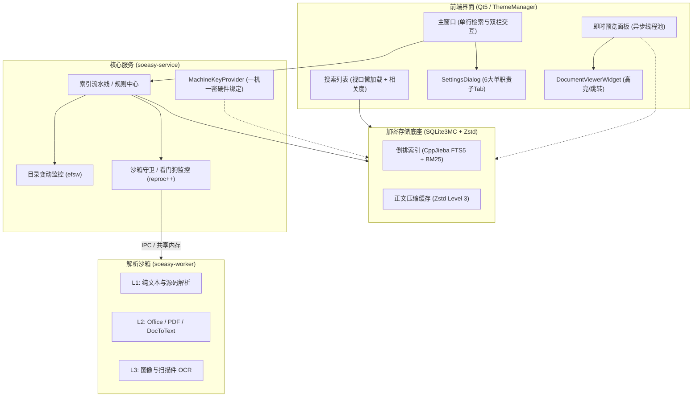

# SoEasy (搜易)

> **让电脑没有难搜的文件**  
> *Make every file searchable on your computer.*

[English](README.md) | [简体中文](README_zh.md)

---

SoEasy 是一款追求极速、安全与稳定的原生跨平台桌面全文检索工具。基于现代 C++17 与 Qt5 构建，完全在本地对代码仓库、文档资料、电子表格、演示文稿、PDF 与图片扫描件进行离线索引与毫秒级搜索。

无 Electron 容器，无云端数据上传，通过物理多进程隔离沙箱保障系统常驻运行的极致轻量与坚固稳定。

---

## 核心设计与特性

- **毫秒级即时全文检索**  
  底层集成 SQLite FTS5 倒排索引引擎与 CppJieba 中文分词，引入 BM25 算法优化相关度排序。支持海量文档中键入即搜，提供富文本上下文高亮摘要与位置定位。

- **崩溃自愈的沙箱隔离与现代进程治理**  
  所有文件解析均置于独立的子进程 (`soeasy-worker`) 沙箱内运行，由主进程守卫 (`WorkerGuard`) 通过共享内存（SHM）与 Cap'n Proto 统一调度。底层引入现代进程库 `reproc++` 与标准 `stop_actions` 严格回收生命周期，彻底根除僵尸进程（`<defunct>`）；Linux 下采用抽象命名空间套接字（Abstract Domain Sockets）实现零磁盘残留的内核级安全 IPC。若遇格式损坏、内存溢出或死循环解析，看门狗毫秒级强杀并透明自愈，彻底杜绝主程序与界面的卡死风险。

- **双数组 Trie (DAT) + mmap 零内存开销分词**  
  采用 Darts-clone 将结巴 35 万词主词典预编译为双数组字典树（Double-Array Trie, DAT）二进制文件，运行时直接通过内核 `mmap` 进行零拷贝只读映射，无需动态构建百万节点内存 Trie 树。堆内存占用从 **120 MB 直降至 7 MB**，实现瞬间冷启动，并提供叠加层（Overlay）支持用户平滑扩展自定义专有名词。

- **低延迟轻量级 OCR 优化引擎**  
  内置 PP-OCRv6 深度学习引擎，采用 Header Probe 内存零拷贝尺寸嗅探（$< 1\,\mu\text{s}$），在解码前即时剔除图标、装饰线条与单色底图；结合双档位自适应检测分辨率策略（独立文档 736px / 文档内嵌图 640px），内存开销骤降 34%，推理速度提升超 40% 且准确率无损；Worker 进程启动配置 `mallopt(M_ARENA_MAX, 2)` 遏制多线程内存碎片，闲置时自动回收。

- **纯本地硬件绑定透明密态存储 (FEAT-006)**  
  零网络依赖，杜绝任何数据上云。索引数据库与正文缓存均采用 SQLite3MultipleCiphers 进行透明页级 AES-128 加密，结合 Zstandard (Zstd) 高效压缩落盘。对齐工业级最佳实践，引入 **“一机一密硬件信封加密”**（`MachineKeyProvider`）：通过 Linux `/etc/machine-id` 或 Windows DPAPI 锚定宿主系统生命周期生成 256 位高熵主密钥，彻底拔除代码中的硬编码口令；脱机拷贝文件物理防解密（报错 `file is not a database`），并支持存量数据库启动时零感知透明迁移。

- **完备的格式覆盖与图文原位抽取**  
  Office 与 PDF 解析由深度优化的 [DocToText (v5.1.2+)](https://github.com/lilucpp/doctotext) 驱动，支持文档内嵌图片的流式 OCR、PDF 图文按自然排版顺序提取、纯图片扫描件自动识别补全与防重复识别。原生支持纯文本、主流编程源码、开放文档 (ODF)、苹果 iWork、RTF 及 EML 邮件，对独立图像自动调用内置 PP-OCRv6 深度学习引擎。

- **现代化高内聚 Qt 架构与异步预览防抖**  
  全面践行单一职责与组件化重构：
  - **异步正文预览组件**：抽取可复用的 `DocumentViewerWidget`，支持关键词 Badge 呈现、全文档命中词轮转导航与即时高亮定位。数据库解密与正文解压全面派发至后台工作线程池 (`QThreadPool`)，配合自增 Request-ID 序列号防抖丢弃机制，彻底杜绝快速切行导致的主线程卡顿。
  - **模块化设置中心**：将 1300+ 行的大上帝类彻底解耦为 6 个独立单职责子页面（`常规`、`目录`、`规则`、`格式`、`词库`、`性能`），基于统一 `ISettingsTab` 接口驱动。
  - **集中式设计语言系统**：统一抽取 `theme_light.qss` 并由 `ThemeManager` 全局管理，便于未来无缝热切换暗色主题。
  - **自定义分词词典可视化 (FEAT-002)**：提供专属词条管理页面，支持即时新增领域专有名词并配置词频，毫秒级热加载入内存 Overlay 叠加层生效。

- **极简单行检索与原生双栏交互体验**  
  采用极致无干扰的纯单行搜索栏设计，秒级自由切换“全文倒排”与“文件名秒搜”；支持实时高亮正文预览（配备 <kbd>Ctrl+P</kbd> 及状态栏一键折叠）；提供独立的 BM25 相关度排序与纯净行号；支持键盘优先全链路导航（<kbd>Enter</kbd> 默认程序秒开、<kbd>Ctrl+O</kbd> 打开所在目录、<kbd>Ctrl+,</kbd> 打开系统设置、<kbd>F1</kbd> 快捷键指南、<kbd>Esc</kbd> 清空搜索词或最小化托盘）；底层接入 `efsw` 实时监听文件变动，具备毫秒级去抖合并与平滑增量热更新能力。

---

## 系统架构



---

## 支持格式列表

| 格式分类 | 文件扩展名 | 文本解析内核 |
| :--- | :--- | :--- |
| **纯文本与源代码** | `.txt`, `.md`, `.log`, `.csv`, `.json`, `.xml`, `.html`, `.c`, `.cpp`, `.py`, `.go`, `.rs`, `.java`, `.ts`, `.sh` 等 | L1 原生解析器 + uchardet 编码嗅探 |
| **Microsoft Office (OOXML)** | `.docx`, `.xlsx`, `.pptx` | L2 DocToText / 快速流解压抽取 |
| **Microsoft Office 经典二进制** | `.doc`, `.xls`, `.ppt`, `.xlsb` | L2 DocToText 专有提取器 |
| **开放文档格式 (ODF)** | `.odt`, `.ods`, `.odp`, `.odg`, `.fodt`, `.fods`, `.fodp` | L2 DocToText |
| **便携式版式文档** | `.pdf` (支持纯文本层及图片扫描件自动判定) | L2 Poppler 文本提取 + 扫描件转排队 |
| **苹果办公套件 (Apple iWork)** | `.pages`, `.numbers`, `.key`, `.keynote` | L2 DocToText |
| **富文本与电子邮件** | `.rtf`, `.eml` | L2 DocToText |
| **独立图像与扫描介质** | `.png`, `.jpg`, `.jpeg`, `.webp`, `.bmp`, `.tiff`, `.tif`, `.jfif`, `.pnm` | L3 PP-OCRv6 深度学习 OCR |
| **压缩归档格式 (规划中)** | `.zip`, `.tar`, `.gz`, `.7z`, `.rar`, `.bz2`, `.xz` *(界面暂置灰待支持)* | 待实现：递归解包检索流水线 (TODO) |

---

## 编译与运行

### 基础环境要求

- **编译器**：支持 C++17 的 GCC 8+、Clang 9+ 或 MSVC 2019+
- **CMake**：3.16 及以上版本
- **核心依赖**：Qt5 (`Widgets`, `Gui`, `Core`)、Cap'n Proto、uchardet、zlib、libxml2、OpenCV

### Linux 原生构建

```bash
# 生成 Release 构建配置
cmake -B build -DCMAKE_BUILD_TYPE=Release

# 编译所有组件
cmake --build build -j$(nproc)

# 启动应用程序
./build/soeasy-gui
```

### Linux 一键打包

```bash
bash scripts/package.sh
```
打包输出产物位于 `dist/soeasy-linux-x86_64.zip`。

### Windows (x64) 容器化交叉编译

本项目提供基于 Docker 的 MinGW-w64 跨平台自动化交叉编译方案，无需 Windows 实体机即可在 Linux 宿主机上一键生成绿色便携包：

```bash
# 1. 构建 MinGW 交叉编译容器镜像
docker build -f Dockerfile.win64 -t soeasy-win64-cross .

# 2. 自动化编译并打包 Windows 发行版
./scripts/package_win64_docker.sh
```

生成的 Windows 发行包位于 `dist/soeasy-windows-x64.zip`，解压至任意 64 位 Windows 机器即可直接运行 `bin/soeasy-gui.exe`。

---

## 性能与系统资源占用基准

基于 Linux x86_64（Release 构建）真实环境实测数据：

| 运行状态 / 操作场景 | 物理内存 (RSS) | CPU 占用 | 优化与机制说明 |
| :--- | :--- | :--- | :--- |
| **静默常驻 / 待机状态** | **约 82 MB** (整机总计) | **0.0%** | GUI 主进程约 76 MB；Worker 进程 **0 个 / 0 MB**（按需懒加载 + 60s 闲置自动销毁退出）；OCR 模型 **0 MB**（闲置卸载）；共享内存池仅 **6 MB**（3 槽位 × 2MB）。整体常驻内存相比重构前（434 MB）**下降超 81%**。 |
| **批量索引峰值 (Peak)** | **约 377 MB** | **约 120%** | 主进程 + 2 个解析 Worker；大文本（>2MB）自动无缝溢出至临时缓存文件，具备四重兜底清理防泄漏。 |
| **文件名秒搜 (10,000+ 文件)** | 几无增量 | < 1% | 基于内存无锁 `NameIndex` 结构，首屏响应耗时 **< 2.0 ms**。 |
| **加密全文检索 (FTS5 + 结巴)** | 几无增量 | < 2% | SQLite3MC AES-128 页级加密倒排查询，单次检索耗时 **< 0.5 ms**。 |
| **Zstd 全文解压吞吐** | 几无增量 | < 1% | 单核解压吞吐速率 **> 5,800 MB/s**，正文高亮预览瞬间呈现。 |

---

## 质量验证与基准测试

项目内置了详尽的单元测试与微基准测试：

```bash
# 执行全量自动化测试套件 (65 个用例全矩阵回归)
cd build && ctest --output-on-failure

# 验证一机一密硬件绑定信封加密机制 (FEAT-006)
./build/test_machine_key_provider_gtest

# 执行 Qt GUI 离线无头自动化冒烟验证
./build/test_gui_smoke

# Office / PDF 多格式深度抽取与沙箱容错测试
./build/test_office_parser
```

---

## 核心依赖与致谢

SoEasy 的极速与稳健构建于优秀的底层开源基石之上：
- **[DocToText (lilucpp 增强版)](https://github.com/lilucpp/doctotext)**：承担 Office 与 PDF 深度文本抽取。相比原版，新增了文档内嵌图片流式 OCR、PDF 图文按自然排版顺序提取、纯图片扫描件自动识别补全与防重复识别机制，并提供跨编译器的稳定纯 C ABI。
- **[SQLite3MultipleCiphers](https://github.com/utelle/SQLite3MultipleCiphers)**：透明页级 AES-128 索引数据库加密。
- **[SQLiteCpp](https://github.com/SRombauts/SQLiteCpp)**：现代 C++ RAII 包装库与事务守护。
- **[CppJieba](https://github.com/yanyiwu/cppjieba)**：SQLite FTS5 毫秒级中文分词引擎。
- **[Darts-clone](https://github.com/s-yata/darts-clone)**：极简双数组字典树（Double-Array Trie）实现，驱动 mmap 零内存占用词典。
- **[reproc / reproc++](https://github.com/DaanDeMeyer/reproc)**：现代跨平台进程生命周期管理与 IPC 管道库，杜绝孤儿与僵尸进程。
- **[Zstandard](https://github.com/facebook/zstd)**：高压缩比文档全文实时压缩缓存。
- **[efsw](https://github.com/SpartanJ/efsw)**：跨平台多后端目录事件异步监控器。

---

## 开源协议

本项目基于 [Apache-2.0 License](LICENSE) 授权开源。
