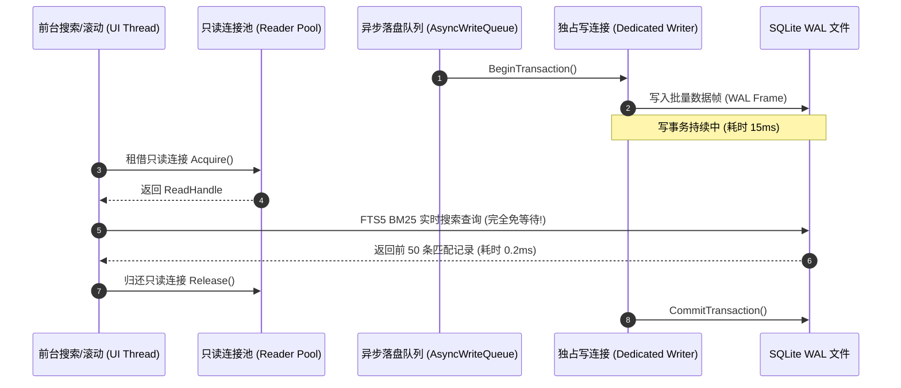

# SoEasy 桌面全文检索系统 —— 架构演进与中微观建模详细设计说明书 (LLD)

> **文档版本**: v1.0.0  
> **文档状态**: Baseline Draft (详细设计基线)  
> **核心架构原则**: CQRS 读写分离、SOLID 设计原则、DbC 契约式设计、SQLite WAL 读写连接池化  
> **关联文档**: [《系统需求规格说明书》(SRS)](../requirements/system_requirements_specification.md) | [《业务规则目录》(BR)](../requirements/business_rules.md) | [《特性跟踪矩阵》](../../TODOLIST.md)

---

## 1. 概述与重构目标

### 1.1 现状审视与核心痛点
SoEasy 经过初期快速迭代，已经在底层构建了极具竞争力的核心基础设施（DAT 树 7MB 零堆分词、PP-OCRv6 剪枝微缩、AES-128 密态存储、多进程 WorkerGuard 共享内存沙箱）。但随着系统复杂度提升，现存代码显露出明显的中观与微观架构债务：
1. **中台“上帝类”过度集中**：`IndexPipeline` 同时负责全量扫盘、变动去抖、任务派发、批量落盘、内存哈希维护、空间回收以及前台检索，违反单一职责原则（SRP）与共同封闭原则（CCP）。
2. **层次穿透与职责泄漏**：表现层 `ResultView` 直接注入了底层 `StorageEngine` 句柄，并在 Qt UI 主线程滚动事件中同步调用 `GetDocumentContent` 解压大文本生成摘要，破坏 MVC 架构。
3. **微观解析器扩展僵化**：Worker 子进程内通过 `if-else` 硬编码分支调度 L1/L2/L3 解析器，缺少统一多态抽象，违反开闭原则（OCP），阻塞后续压缩包格式（FEAT-004）的优雅接入。
4. **粗粒度互斥锁抑制并发吞吐**：`StorageEngine` 采用单一 `sqlite3*` 句柄与单一把 `engine_mutex_` 全局锁，导致前台实时搜索、摘要生成与后台批量写入、Vacuum 回收相互阻塞，未能释放 SQLite WAL 模式“读写互不阻塞”的物理特性。
5. **Item-Based 视图内存开销大**：`ResultView` 继承自 `QTableWidget`，每个单元格生成独立的 `QTableWidgetItem` 堆对象，未采用虚拟化 Model/View 机制。

### 1.2 架构重构核心目标
- **目标 1 (中观架构解耦)**：基于 CQRS 原则拆解 `IndexPipeline` 为独立的读中台（`SearchCoordinator`）与写中台（`IndexOrchestrator`），确立严格单向无环的组件依赖图。
- **目标 2 (微观策略多态)**：在 Worker 沙箱引入 `IDocumentParser` 统一契约与 `ParserRegistry` 责任链，实现解析器热插拔与优先级匹配。
- **目标 3 (并发物理提速)**：将 `StorageEngine` 升级为“独占写连接 + 只读连接池”架构，消除读写争锁，实现后台入库与前台检索真正的内核级并行。
- **目标 4 (表现层虚拟化与防穿透)**：重构 `ResultView` 为 `QTableView` + `SearchTableModel` 虚拟视口，彻底剥离对存储引擎的直连，收拢至服务层异步通道。

---

## 2. 总体架构与中观拓扑设计 (Meso Architecture)

### 2.1 模块依赖有向无环图 (DAG)

系统重构后的中观依赖拓扑严格遵守**无环依赖原则 (ADP)** 与**稳定抽象原则 (SAP)**：

```mermaid
flowchart TD
    subgraph Layer_GUI ["表现层 (Presentation Layer)"]
        MainWindow["MainWindow"]
        ResultView["ResultView (QTableView)"]
        SearchTableModel["SearchTableModel (QAbstractTableModel)"]
        PreviewPanel["PreviewPanel"]
    end

    subgraph Layer_Service ["服务中台层 (Service Layer - CQRS)"]
        subgraph Read_Model ["读模型 (Read Pipeline)"]
            ISearchService["ISearchService (Interface)"]
            SearchCoordinator["SearchCoordinator"]
            SnippetProvider["SnippetProvider (异步摘要器)"]
        end
        subgraph Write_Model ["写模型 (Write Pipeline)"]
            IIndexController["IIndexController (Interface)"]
            IndexOrchestrator["IndexOrchestrator"]
            EventDebouncer["EventDebouncer"]
            WatchEngine["WatchEngine"]
            AsyncWriteQueue["AsyncWriteQueue"]
        end
        NameIndex["NameIndex (内存哈希倒排)"]
        WorkerGuard["WorkerGuard (沙箱池守卫)"]
    end

    subgraph Layer_Storage ["持久化存储底座 (Storage Layer)"]
        IStorageEngine["IStorageEngine (Interface)"]
        StorageEnginePool["StorageEngine (池化实现)"]
        WriterConn["独占写入连接 (Writer)"]
        ReaderPool["只读连接池 (Reader Pool: 2~4 Connections)"]
    end

    subgraph Layer_Worker ["沙箱解析进程池 (Worker Subprocesses)"]
        WorkerLoop["WorkerLoop"]
        ParserRegistry["ParserRegistry (责任链)"]
        IDocumentParser["IDocumentParser (Interface)"]
        L1Parser["L1TextParser"]
        L2Parser["L2OfficeParser"]
        L3Parser["L3ImageParser"]
        ArchiveParser["ArchiveParser (Future FEAT-004)"]
    end

    %% GUI -> Service 依赖
    MainWindow --> ISearchService
    MainWindow --> IIndexController
    ResultView --> SearchTableModel
    SearchTableModel --> ISearchService
    PreviewPanel --> ISearchService

    %% Service 内部拓扑
    SearchCoordinator -.->|实现| ISearchService
    SearchCoordinator --> NameIndex
    SearchCoordinator --> SnippetProvider
    SearchCoordinator --> IStorageEngine

    IndexOrchestrator -.->|实现| IIndexController
    IndexOrchestrator --> WatchEngine
    IndexOrchestrator --> EventDebouncer
    IndexOrchestrator --> WorkerGuard
    IndexOrchestrator --> AsyncWriteQueue
    IndexOrchestrator --> NameIndex
    AsyncWriteQueue --> IStorageEngine

    %% Storage 内部
    StorageEnginePool -.->|实现| IStorageEngine
    StorageEnginePool --> WriterConn
    StorageEnginePool --> ReaderPool

    %% IPC 隔离边界
    WorkerGuard ==>|IPC / SHM / reproc++| WorkerLoop

    %% Worker 内部策略
    WorkerLoop --> ParserRegistry
    ParserRegistry --> IDocumentParser
    L1Parser -.->|实现| IDocumentParser
    L2Parser -.->|实现| IDocumentParser
    L3Parser -.->|实现| IDocumentParser
    ArchiveParser -.->|实现| IDocumentParser
```



---

## 3. 微观模块建模与类契约设计 (Micro Architecture)

### 3.1 模块一：解析器策略责任链 (`IDocumentParser` + `ParserRegistry`)

#### 3.1.1 接口契约定义
在 `src/worker/` 目录定义统一文档解析契约：

```cpp
namespace soeasy::worker {

struct ParseContext {
  int64_t doc_id = 0;
  std::string file_path;
  std::string ext;                      // 小写无点后缀，如 "docx", "cpp", "png"
  uint64_t file_size = 0;
  uint32_t timeout_ms = 15000;
  bool enable_embedded_ocr = false;     // 是否触发嵌入式图像 OCR
};

struct ExtractedDocument {
  std::string utf8_text;                // 归一化 UTF-8 纯文本
  bool is_scanned_pdf = false;          // 纯图像扫描件标识
  size_t page_count = 0;                // 文档页数（如适用）
  std::string metadata_json;            // 扩展元数据 (作者/标题/创建时间等)
};

class IDocumentParser {
 public:
  virtual ~IDocumentParser() = default;

  /**
   * @brief 判定当前解析器是否支持处理该文件
   * @pre ctx.file_path 必须可读且有效
   * @return true 若具备解析能力
   */
  [[nodiscard]] virtual bool CanHandle(const ParseContext &ctx) const = 0;

  /**
   * @brief 执行正文与元数据提取
   * @pre CanHandle(ctx) == true
   * @post 若返回 true，out_doc->utf8_text 必须为合法 UTF-8 编码串
   */
  [[nodiscard]] virtual bool Parse(const ParseContext &ctx, ExtractedDocument *out_doc) = 0;

  /**
   * @brief 解析器优先级。数值越大越优先被责任链匹配
   * 默认：L3(图像/OCR)=30, L2(复杂文档/PDF)=20, L1(纯文本/代码)=10
   */
  [[nodiscard]] virtual int Priority() const { return 0; }

  /**
   * @brief 解析器唯一定位标识符
   */
  [[nodiscard]] virtual std::string Name() const = 0;
};

}  // namespace soeasy::worker
```

#### 3.1.2 注册中心与责任链 (`ParserRegistry`)
```cpp
namespace soeasy::worker {

class ParserRegistry {
 public:
  ParserRegistry();
  ~ParserRegistry() = default;

  void RegisterParser(std::unique_ptr<IDocumentParser> parser);

  /**
   * @brief 责任链驱动：按优先级依次询问 CanHandle，首个命中的解析器执行 Parse
   */
  bool ParseDocument(const ParseContext &ctx, ExtractedDocument *out_doc);

  /**
   * @brief 检查系统是否对指定后缀具备处理能力
   */
  bool IsSupported(const std::string &ext) const;

 private:
  std::vector<std::unique_ptr<IDocumentParser>> parsers_; // 按 Priority 降序排列
  mutable std::mutex registry_mutex_;
};

}  // namespace soeasy::worker
```

#### 3.1.3 演进优势
1. **彻底消除 `worker_loop` 中的硬编码**：`worker_loop.cpp` 缩减为向 `ParserRegistry::ParseDocument` 投递 `ParseContext`。
2. **解耦测试**：各解析器派生类可通过标准的 Mock `ParseContext` 独立运行单测，无须启动 IPC。
3. **为 FEAT-004（压缩包正文递归检索）铺平道路**：未来只需实现 `ArchiveParser : public IDocumentParser` 并 `RegisterParser`，无需变动主循环任何一行代码。

---

### 3.2 模块二：存储引擎读写分离连接池 (`IStorageEngine` + `ConnectionPool`)

#### 3.2.1 并发模型分析与 SQLite WAL 拓扑
SQLite 在开启 WAL（Write-Ahead Logging）后具备天然的读写并行能力：
- **写互斥 (Single Writer)**：同一个时刻仅允许一个事务持有写锁；
- **读并发 (Concurrent Readers)**：多个连接可以同时读取 DB，且完全不阻塞写事务（读事务读取的是快照页面）；
- **瓶颈破除**：当前代码因为只有一个 `sqlite3*` 句柄，不得不加互斥锁；重构为**多连接模型**后，前台读连接完全不经过写锁。



#### 3.2.2 存储抽象接口 (`IStorageEngine`)
提取纯虚接口，便于测试打桩与存储引擎替换：
```cpp
namespace soeasy::storage {

class IStorageEngine {
 public:
  virtual ~IStorageEngine() = default;

  // --- 生命周期 ---
  virtual bool Open(const std::string &db_path, const std::string &key, const std::string &dict_dir) = 0;
  virtual void Close() = 0;
  virtual bool is_open() const = 0;

  // --- 读操作接口 (线程安全，支持并发，走只读连接池) ---
  virtual std::vector<SearchResultItem> SearchFulltext(const std::string &query, int limit, int offset,
                                                       const std::string &path_prefix, int *out_total_count) = 0;
  virtual bool GetDocumentContent(int64_t doc_id, std::string *out_content) = 0;
  virtual bool GetFileMetadata(int64_t doc_id, uint64_t *out_size, int64_t *out_mtime) = 0;
  virtual StorageFragmentation GetFragmentationStats() = 0;

  // --- 写操作接口 (由写线程独占调用，走专用写连接) ---
  virtual bool BeginTransaction() = 0;
  virtual bool CommitTransaction() = 0;
  virtual bool RollbackTransaction() = 0;
  virtual bool IndexDocument(int64_t doc_id, const std::string &path, const std::string &filename,
                             const std::string &ext, uint64_t file_size, int64_t mtime,
                             int parse_level, const std::string &content) = 0;
  virtual bool DeleteDocument(int64_t doc_id) = 0;
  virtual bool DeleteDirectory(const std::string &dir_path) = 0;
  virtual bool IncrementalVacuum(int max_pages) = 0;
  virtual bool CheckpointWal() = 0;
};

}  // namespace soeasy::storage
```

#### 3.2.3 只读连接池实现机制 (`ReadConnectionGuard`)
```cpp
namespace soeasy::storage {

class ScopedReadConnection {
 public:
  ScopedReadConnection(sqlite3 *db, std::function<void(sqlite3 *)> release_fn)
      : db_(db), release_fn_(std::move(release_fn)) {}
  ~ScopedReadConnection() {
    if (db_ && release_fn_) {
      release_fn_(db_);
    }
  }
  sqlite3 *get() const { return db_; }

 private:
  sqlite3 *db_ = nullptr;
  std::function<void(sqlite3 *)> release_fn_;
};

}  // namespace soeasy::storage
```
- **连接池管理规则与鉴权不变式 (DbC Invariant)**：
  - **连接开辟一致性契约**：每个新开辟的只读连接（`SQLITE_OPEN_READONLY`）**必须严格执行与主连接同等的鉴权初始化**：
    1. 调用 SQLite3MC 注入加密主密钥并校验（`sqlite3_key` / `PRAGMA key = ...`）；
    2. 调用 `RegisterFts5JiebaTokenizer(db, dict_dir)` 挂载相同的 DAT 分词模块，确保 FTS5 倒排索引查询能力；
    3. 设置读端 PRAGMA：`PRAGMA query_only = ON; PRAGMA temp_store = MEMORY; PRAGMA mmap_size = 268435456;`。
  - **池化资源治理**：默认维持 3 个只读连接，放入无锁或轻量互斥连接队列。若高并发下池耗尽，支持根据上限（如最大 8 个）按需创建临时连接或带超时等待（100ms），归还时验证连接健康度（若发生 `SQLITE_CORRUPT` 或致命异常直接关闭销毁并补足新连接）。

---

### 3.3 模块三：中台读写解耦架构 (CQRS: `SearchCoordinator` + `IndexOrchestrator`)

#### 3.3.1 读中台：`SearchCoordinator` (`ISearchService`)
负责满足前台用户交互所有的查询、分页、摘要提取与高亮诉求：
```cpp
namespace soeasy::service {

struct SearchRequest {
  std::string query;
  int mode = 0;                 // 0: 全文, 1: 文件名
  std::string path_scope;
  int limit = 50;
  int offset = 0;
};

struct SearchResponse {
  std::vector<storage::SearchResultItem> items;
  int total_count = 0;
  double elapsed_ms = 0.0;
  bool has_more = false;
};

class ISearchService {
 public:
  virtual ~ISearchService() = default;

  /**
   * @brief 同步检索（供轻量文件名检索或后台测试）
   */
  virtual SearchResponse Search(const SearchRequest &req) = 0;

  /**
   * @brief 异步检索（UI 主线程推荐调用，避免主线程发生任何磁盘 I/O）
   */
  virtual std::future<SearchResponse> SearchAsync(SearchRequest req) = 0;

  /**
   * @brief 异步按需提取文本摘要 (供列表虚拟视口滚动懒加载)
   */
  virtual std::future<std::string> FetchSnippetAsync(int64_t doc_id, std::vector<std::string> keywords,
                                                     size_t max_len) = 0;
};

}  // namespace soeasy::service
```

#### 3.3.2 写中台：`IndexOrchestrator` (`IIndexController`)
负责管理后台扫描、变动捕获、沙箱派发、批处理写队列及存储整理的完整生命周期：
```cpp
namespace soeasy::service {

class IIndexController {
 public:
  virtual ~IIndexController() = default;

  virtual bool Init() = 0;
  virtual bool StartLiveWatch() = 0;
  virtual void StopLiveWatch() = 0;

  virtual bool AddDirectory(const std::string &dir_path, bool recursive) = 0;
  virtual bool RemoveDirectory(const std::string &dir_path) = 0;

  virtual void StartInitialScanAsync(std::function<void(size_t indexed, size_t total, const std::string &path)> progress_cb) = 0;
  virtual void CancelScan() = 0;
  virtual bool IsScanActive() const = 0;

  virtual void TriggerAsyncVacuum() = 0;
  virtual PipelineStats GetStats() const = 0;
};

}  // namespace soeasy::service
```

#### 3.3.3 平滑演进与测试兼容保障 (Facade 外观模式)
为了杜绝重构破坏既有单元测试与调用端（避免发散式霰弹修改），`IndexPipeline` 将演化为**统一外观类 (Facade)**：
- 内部同时组合 `std::shared_ptr<SearchCoordinator>` 与 `std::shared_ptr<IndexOrchestrator>`；
- 保留原有对外 API（如 `SearchFulltext`, `PerformInitialScan`, `RemoveDirectoryIndex`），将读操作委托给 `SearchCoordinator`，写操作委托给 `IndexOrchestrator`；
- **收益**：既有的 `tests/test_watch_and_index.cpp`、`tests/test_logging_and_rebuild.cpp` 无须修改一行测试代码即可平滑过渡，测试持续通过率 100%。

---

### 3.4 模块四：表现层虚拟化与防穿透治理 (`QTableView` + `SearchTableModel`)

#### 3.4.1 虚拟模型设计 (`SearchTableModel`)
彻底废弃 `QTableWidget` 逐格分配 `QTableWidgetItem` 的低效做法，改用继承 `QAbstractTableModel`：
```cpp
namespace soeasy::gui {

class SearchTableModel : public QAbstractTableModel {
  Q_OBJECT

 public:
  enum ColumnIndex {
    kColIndex = 0,
    kColName = 1,
    kColPath = 2,
    kColSize = 3,
    kColMtime = 4,
    kColScore = 5,
    kColumnCount = 6
  };

  explicit SearchTableModel(QObject *parent = nullptr);

  int rowCount(const QModelIndex &parent = QModelIndex()) const override;
  int columnCount(const QModelIndex &parent = QModelIndex()) const override;
  QVariant data(const QModelIndex &index, int role = Qt::DisplayRole) const override;
  QVariant headerData(int section, Qt::Orientation orientation, int role = Qt::DisplayRole) const override;

  void SetResults(std::vector<DisplayResultItem> items);
  void AppendResults(const std::vector<DisplayResultItem> &items);
  void UpdateSnippet(int64_t doc_id, const QString &snippet_html);
  void Clear();

  const DisplayResultItem *GetItemAt(int row) const;

 private:
  std::vector<DisplayResultItem> items_;
  std::unordered_map<int64_t, size_t> doc_id_to_row_; // 用于快速定位摘要更新行
};

}  // namespace soeasy::gui
```

#### 3.4.2 视口异步摘要调度器 (`ViewportSnippetScheduler`)
切断 `ResultView` 直连 `StorageEngine` 的调用：
1. `ResultView` 仅感知当前可视窗口的行号范围（`visualRect` 范围）；
2. 发现可视区域内条目的 `snippet_html` 为空时，通过 Qt 信号或事件调用 `ISearchService::FetchSnippetAsync`；
3. 后台线程池解压并生成高亮摘要后，通过 Qt 事件循环（`QMetaObject::invokeMethod`）回调更新 `SearchTableModel` 对应行；
4. **UI 主线程完全免去任何 Zstd 解压缩与数据库读取，帧率稳定在 60fps**；
5. **防竞态与幽灵渲染保障 (Stale Async Guard)**：每次用户发起新搜索或清空输入时递增 `query_epoch_`；异步摘要完成回调时，严格校验任务所属的 `epoch` 与当前界面活跃 `query_epoch_` 是否一致，若已进入下一轮搜索或文档已不在当前视图中，直接安全丢弃过期的摘要更新，杜绝乱序脏渲染。

---

## 4. 实施路线图与验证卡点 (Implementation Gates)

为了保证生产环境代码与持续集成测试“步步为营、绝不中断”，重构划分为四个严格的工程阶段：

| 阶段 | 核心任务 | 受影响文件与模块 | 验收卡点 (Quality Gate) |
| :--- | :--- | :--- | :--- |
| **阶段一** | **解析器多态与责任链** | `src/worker/` 下各解析器及 `worker_loop` | `test_office_parser`、`test_image_ocr` 100% 通过；新增 `ParserRegistry` 单元测试 |
| **阶段二** | **存储引擎读写连接池** | `src/storage/storage_engine.*` | 运行并发压测用例：在后台 1000 篇文档写事务执行期间，前台并发执行 100 次 FTS5 检索，P99 延迟 $< 2\text{ms}$，零死锁 |
| **阶段三** | **中台 CQRS 读写分离** | 拆分 `IndexPipeline` 为 `SearchCoordinator` 与 `IndexOrchestrator` | `test_watch_and_index`、`test_logging_and_rebuild` 全量通过；所有检索调用重定向至读模型 |
| **阶段四** | **GUI 虚拟模型重构** | `src/gui/result_view.*`、`main_window.*` | 消除 `SetStorageEngine` 穿透调用；`test_gui_smoke` 通过；列表万级数据加载内存下降 60% |

---

## 5. 结论与基线确认

本详细设计说明书（LLD）系统性地解决了 SoEasy 当前在架构中观（包与中台职责）与微观（接口契约、并发模型、表现层虚拟化）存在的全部已知结构性缺陷，完全契合 Karl Wiegers、Uncle Bob 与 Martin Fowler 倡导的现代演进式架构规范。

经确认后，系统将正式按照**阶段一至阶段四**的实施路线逐步推进落地。
