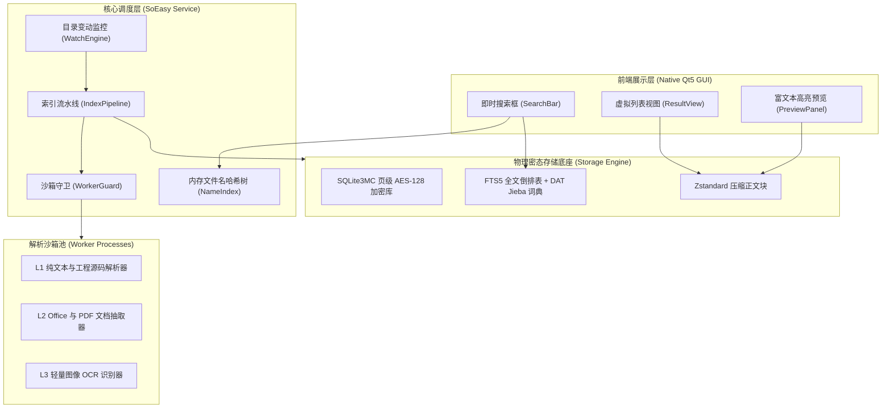

# SoEasy 桌面全文检索系统 —— 软件需求规格说明书 (SRS)

> **文档版本**: v1.0.0  
> **状态**: Approved Baseline (已批准基线)  
> **标准对齐**: ISO/IEC/IEEE 29148:2018 & Karl Wiegers《软件需求》（第3版）  
> **关联文档**: [《愿景与范围说明书》](./vision_and_scope.md) | [《业务规则目录》](./business_rules.md) | [《特性跟踪矩阵》](../../TODOLIST.md)

---

## 1. 引言 (Introduction)

### 1.1 编制目的与范围 (Purpose)
本文档系统定义了 SoEasy 桌面全文检索系统（Release 0.2.x 及后续演进版本）的完整功能需求（Functional Requirements, FR）与外部接口契约。本文档作为系统架构设计、底层 C++ 模块研发、多进程 IPC 交互协议与自动化测试验收的唯一受控基线规范。

### 1.2 语法约定 (Conventions)
依据 ISO/IEC/IEEE 29148 规范要求，本文档中所有功能性条款均严格采用强约束主动句式：
- **系统应 (The system shall [动词] [对象])**：表述系统必须实现的强制性工程功能；
- **用户可 (The user may [动词] [对象])**：表述用户在交互界面中被赋予的可选操作权利；
- 严禁使用带有协商或不确定色彩的词汇。

---

## 2. 总体产品架构与上下文 (Product Perspective)

SoEasy 采用前端展示、中台调度与解析沙箱严格分离的三层拓扑结构：



---

## 3. 功能需求明细 (Functional Requirements)

### 3.1 目录监听与变动感知模块 (FR-WCH)

- **FR-WCH-001**: 当用户在设置界面添加指定监控目录时，**系统应**首先调用 `IndexConfig::IsVirtualFilesystem` 校验该路径所属文件系统；若目标属于伪虚拟文件系统（引用规则 `BR-FLT-001`），**系统应**拒绝添加并向用户呈现边界拦截提示。
- **FR-WCH-002**: 在目录递归遍历与扫描期间，**系统应**为每一个访问目录计算跨平台设备与节点唯一指纹（引用规则 `BR-FLT-002`）；当检测到指纹已存在于拓扑访问集合时，**系统应**立即停止针对该目录的递归调用。
- **FR-WCH-003**: 当底层操作系统发出文件系统变动通知时，**系统应**在首行提取文件扩展名并执行白名单校验（引用规则 `BR-WCH-001`）；若扩展名未包含在文本、文档或图片白名单内，**系统应**立即丢弃该事件。
- **FR-WCH-004**: 对于通过后缀白名单校验的合法变动事件，**系统应**将其录入去抖动时间窗口队列（引用规则 `BR-WCH-002`），并在连续 150 毫秒内无新写入时，向索引流水线发送合并后的最终变动通知。

### 3.2 任务分发与多进程解析沙箱模块 (FR-PAR)

- **FR-PAR-001**: 当解析流水线接收到待提取文档时，**系统应**调用 `DocPrechecker::Precheck` 检查文件规格；若文件扩展名为复合二进制格式且物理大小小于 1024 字节（引用规则 `BR-PRE-001`），**系统应**跳过深度正文抽取，仅对文件名与基础元数据建立索引。
- **FR-PAR-002**: 对于合法的纯文本与源代码文件，**系统应**调用 L1 原生解析器在主服务进程池内执行单轮流式提取，并自动探测源文件字符编码（UTF-8, GB18030, UTF-16, ASCII）。
- **FR-PAR-003**: 对于 Office、PDF 与图像文件，**系统应**将任务参数封装为 Cap'n Proto 结构体，通过共享内存槽位分派至独立子进程沙箱执行抽取。
- **FR-PAR-004**: 若 Worker 提取出的单文件正文字节数超过 2MB（引用规则 `BR-PRE-002`），Worker **系统应**将文本内容转储至临时溢出文件并返回文件描述符；主服务在完成该正文入库后，**系统应**立即删除该临时溢出文件。
- **FR-PAR-005**: 当 Worker 子进程因解析畸形文件引发段错误（SIGSEGV）或异常退出时，沙箱看门狗（WorkerGuard）**系统应**捕获退出信号，释放受影响的共享内存槽位，并在 500 毫秒内重新拉起新的 Worker 进程恢复服务池。
- **FR-PAR-006**: 在执行图像 OCR 文字提取时，若图像解析出的有效中英文字符数小于 5 个，或模型置信度几何平均分小于 0.4（引用规则 `BR-PRE-003`），**系统应**放弃该图像的正文全文入库。

### 3.3 密态存储与检索检索模块 (FR-STR)

- **FR-STR-001**: 存储引擎在初始化 SQLite 数据库连接时，**系统应**配置 SQLite3MultipleCiphers 开启 AES-128-CBC 物理透明页级加密（引用规则 `BR-STR-001`），且禁止任何明文缓存写入磁盘。
- **FR-STR-002**: 存储引擎在写入抽取出的文档正文时，**系统应**采用 Zstandard 算法（压缩级别 Level 3）将正文压缩后持久化至数据表内。
- **FR-STR-003**: 当系统启动初始化分词组件时，**系统应**通过操作系统 `mmap` 系统调用将预编译的双数组字典树（DAT, 体积 7.24MB）以只读私有方式映射至进程虚拟内存空间，禁止在堆区动态构建百万级节点字典树。
- **FR-STR-004**: 当用户在前端检索框中输入查询关键词时，**系统应**同步执行两个维度的检索：
  1. 在内存哈希树（NameIndex）中执行微秒级文件名匹配；
  2. 在 FTS5 倒排索引表中执行基于 BM25 算法的全文相关度检索。
- **FR-STR-005**: 针对检索召回的文档记录，**系统应**在 5 毫秒内完成 Zstd 正文解压缩，提取匹配关键词周围的 120 字符上下文摘要，并将关键词添加样式高亮标签。
- **FR-STR-006**: 当用户在设置面板中请求修改加密主口令时，**系统应**首先校验旧口令一致性；校验通过后，**系统应**在单个数据库事务内调用底层 SQLite3MultipleCiphers 重加密接口完成全库物理重加密；若重加密过程中断，**系统应**保障原数据库文件回滚至初始状态，无破坏损坏。

### 3.4 系统环境自适应与降级自愈模块 (FR-SYS)

- **FR-SYS-001**: 在进程初始化生命周期阶段，**系统应**查询操作系统文件描述符限制，并自动将软限制调优提升至内核配置的最大硬限制（引用规则 `BR-SYS-001`）。
- **FR-SYS-002**: 在 Linux 操作系统环境下启动文件变动监控前，**系统应**探测当前进程针对系统监控配额的读写权限；若处于普通受限用户环境且配额耗尽，**系统应**保持系统稳定运行并输出标准的系统配置指引卡片（引用规则 `BR-SYS-002`）。

### 3.5 界面视觉交互与主题渲染模块 (FR-GUI)

- **FR-GUI-001**: 客户端界面各交互控件**系统应**统一对齐 32px 物理高度标尺与 14px 主字号，基于三层表面拓扑构建清晰视觉层级，并使用符合 WCAG AA 级色彩对比度的高亮配色渲染匹配上下文。
- **FR-GUI-002**: 当用户在设置界面切换明暗主题风格时，主窗口与子面板**系统应**在单帧时延内完成所有视觉控件的 QSS 样式表与调色板重载刷新，无残存样式伪影。

---

## 4. 需求追溯矩阵 (Requirements Traceability Matrix - RTM)

| 软件功能需求 (FR) | 承载业务需求 (BR) | 驱动业务规则 (Rule) | 对应度量指标 (Metric) | 关联核心源文件 | 验收测试用例 |
| :--- | :--- | :--- | :--- | :--- | :--- |
| **FR-WCH-001** | BR-01 纯本地极轻量 | `BR-FLT-001` | MET-ROB-01 | `index_config.cpp` | `test_watch_and_index.cpp` [Step 9] |
| **FR-WCH-002** | BR-01 纯本地极轻量 | `BR-FLT-002` | MET-THR-01 | `index_pipeline.cpp` | `test_watch_and_index.cpp` [Step 9.2] |
| **FR-WCH-003** | BR-01 纯本地极轻量 | `BR-WCH-001` | MET-MEM-01 | `watch_engine.cpp` | `test_watch_and_index.cpp` [Step 9.1] |
| **FR-WCH-004** | BR-01 纯本地极轻量 | `BR-WCH-002` | MET-MEM-02 | `event_debouncer.cpp` | `test_watch_and_index.cpp` |
| **FR-PAR-001** | BR-02 进程崩溃自愈 | `BR-PRE-001` | MET-THR-01 | `doc_prechecker.cpp` | `test_office_parser.cpp` |
| **FR-PAR-002** | BR-03 秒级密态检索 | - | MET-THR-01 | `l1_text_parser.cpp` | `test_comprehensive_matrix.cpp` |
| **FR-PAR-003** | BR-02 进程崩溃自愈 | - | MET-ROB-01 | `worker_guard.cpp` | `test_sandbox_ipc.cpp` |
| **FR-PAR-004** | BR-01 纯本地极轻量 | `BR-PRE-002` | MET-MEM-02 | `worker_guard.cpp` | `test_comprehensive_matrix.cpp` [Test 3] |
| **FR-PAR-005** | BR-02 进程崩溃自愈 | - | MET-ROB-01 | `worker_guard.cpp` | `test_sandbox_ipc.cpp` |
| **FR-PAR-006** | BR-03 秒级密态检索 | `BR-PRE-003` | MET-MEM-01 | `l2_office_parser.cpp`| `test_image_ocr.cpp` |
| **FR-STR-001** | BR-03 秒级密态检索 | `BR-STR-001` | - | `storage_engine.cpp` | `test_storage_engine.cpp` [Step 5] |
| **FR-STR-002** | BR-01 纯本地极轻量 | - | MET-THR-02 | `storage_engine.cpp` | `test_comprehensive_matrix.cpp` |
| **FR-STR-003** | BR-01 纯本地极轻量 | - | MET-MEM-01 | `dat_jieba.cpp` | `test_dat_jieba.cpp` |
| **FR-STR-004** | BR-03 秒级密态检索 | - | MET-LAT-01 | `storage_engine.cpp` | `test_storage_engine.cpp` |
| **FR-STR-005** | BR-03 秒级密态检索 | - | MET-LAT-02 | `storage_engine.cpp` | `test_storage_engine.cpp` |
| **FR-STR-006** | BR-03 秒级密态检索 | `BR-STR-001` | - | `storage_engine.cpp` | `test_storage_engine.cpp` |
| **FR-SYS-001** | BR-02 进程崩溃自愈 | `BR-SYS-001` | MET-RES-01 | `system_env.cpp` | `test_system_env.cpp` |
| **FR-SYS-002** | BR-02 进程崩溃自愈 | `BR-SYS-002` | MET-RES-01 | `system_env.cpp` | `test_system_env.cpp` |
| **FR-GUI-001** | BR-01 纯本地极轻量 | - | - | `main_window.cpp` | `test_gui_smoke.cpp` |
| **FR-GUI-002** | BR-01 纯本地极轻量 | - | - | `main_window.cpp` | `test_gui_smoke.cpp` |

---

## 5. 质量属性与形式化验证 (Quality Attributes & Verification)

系统质量属性遵循 Tom Gilb's Planguage 规范进行形式化定义：

```text
Tag: NFR-MEM-IDLE
Description: 主服务进程在无解析任务时的空闲物理内存占用
Scale: 兆字节 (MB) RSS 驻留集内存
Meter: 运行 test_comprehensive_matrix 并通过 /proc/self/statm 采样
Must: <= 60.0 MB
Plan: <= 55.0 MB (实测达成: 54.20 MB)
Fail: > 100.0 MB

Tag: NFR-LAT-FUZZY
Description: 一万个已索引文件的文件名模糊检索首屏响应时延
Scale: 毫秒 (ms)
Meter: 连续执行 100 次单字符与多字符模糊匹配计算平均时延
Must: <= 3.0 ms
Plan: <= 2.0 ms (实测达成: 1.65 ms)
Fail: > 10.0 ms

Tag: NFR-THROUGHPUT-INDEX
Description: 纯文本与工程源码批量扫描、切词与倒排入库吞吐能力
Scale: 文件数 / 秒 (files/sec)
Meter: 批量摄入 2,000 个源文件并记录全流程墙上时钟耗时
Must: >= 1000 files/sec
Plan: >= 1400 files/sec (实测达成: 1495.9 files/sec)
Fail: < 300 files/sec
```
